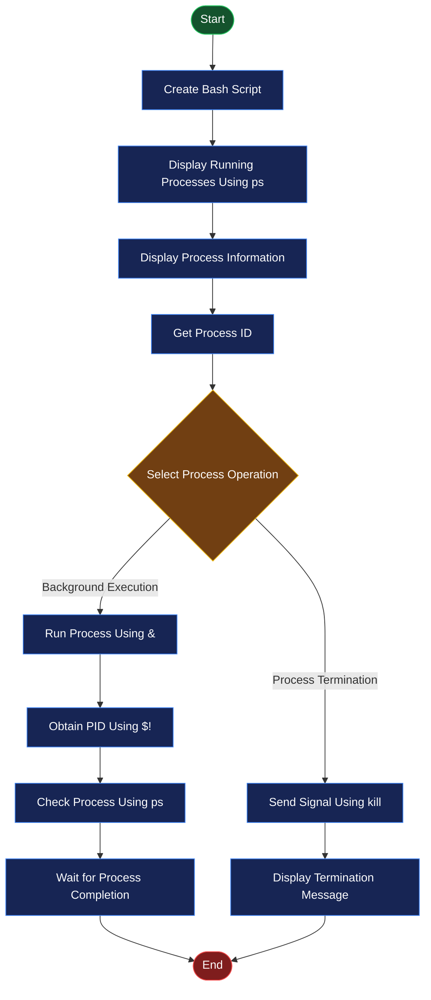
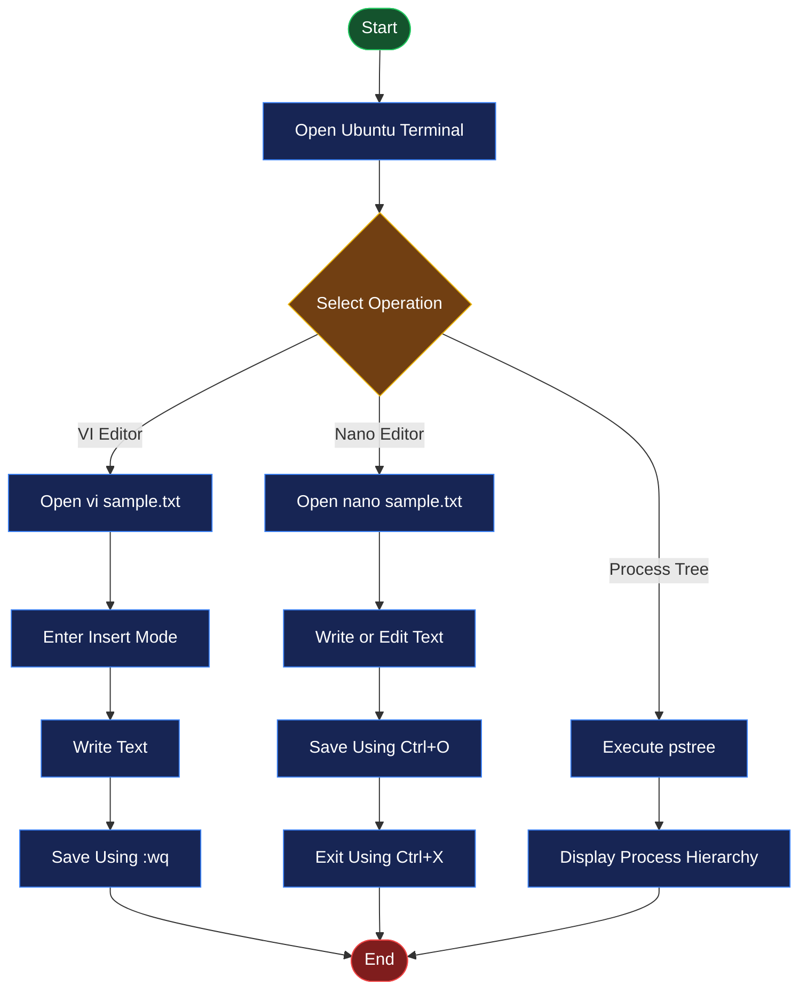

# 🖥️ EXPERIMENT NO. 04
# PROCESS MANAGEMENT AND TEXT EDITORS IN LINUX

<p align="center">
  
  
  
</p>

<p align="center">
  <b>Operating System Practical Laboratory</b><br>
  Understanding Process Management, Process Identification, Background Execution and Linux Text Editors.
</p>

---

## 📌 1. Aim

To study and implement various **Process Management Commands and Text Editor Operations** in Linux using Bash shell scripts, VI Editor and Nano Editor.

## 🎯 2. Objectives

- To understand the concept of process management in Linux.
- To display currently running processes using `ps`.
- To obtain process information such as PID and user details.
- To monitor processes using the `top` command.
- To execute processes in the background.
- To terminate a running process using the `kill` command.
- To understand basic operations of the VI text editor.
- To understand basic operations of the Nano text editor.
- To display the process hierarchy using the `pstree` command.

## 💻 3. Requirements

| Component | Description |
|---|---|
| Operating System | Ubuntu Linux |
| Virtualization | Oracle VirtualBox |
| Shell | Bash Shell |
| Language | Shell Scripting |
| Text Editors | VI and Nano |
| Terminal | Linux Terminal |
| Commands | ps, top, sleep, kill, pstree, whoami |

---

## 📚 4. Introduction / Theory

### A. Process Management

A **process** is a program that is currently being executed by the operating system.

Linux manages multiple processes simultaneously and allocates CPU time and other system resources to them.

Every process is identified by a unique number called the **Process ID (PID)**.

**Important Process Management Commands:**

| Command | Description |
|---|---|
| `ps` | Displays currently running processes associated with the terminal. |
| `ps -ef` | Displays detailed information about all processes. |
| `top` | Displays real-time process information. |
| `kill PID` | Sends a termination signal to a process. |
| `sleep` | Delays execution for a specified time. |
| `pstree` | Displays processes in a tree structure. |
| `whoami` | Displays the current username. |
| `echo $$` | Displays the current shell process ID. |

### B. Process ID (PID)

PID stands for Process ID. It is a unique identification number assigned to every process running in Linux.

Example:

```bash
echo $$
```

This command displays the PID of the current shell.

### C. Foreground and Background Processes

**Foreground Process:**

A foreground process runs directly in the terminal and normally keeps the terminal occupied until it finishes.

**Background Process:**

A background process runs without keeping the terminal occupied.

The `&` operator is used to execute a command in the background.

Example:

```bash
sleep 30 &
```

### D. Process Termination

Process termination means stopping a running process.

The `kill` command sends a signal to a process using its PID.

Example:

```bash
kill 1234
```

By default, `kill` sends the SIGTERM signal, which requests the process to terminate.

### E. VI Text Editor

VI is a command-line text editor available in Linux. It is used to create, edit and save text files.

**Main Modes of VI Editor:**

1. Command Mode – Used to execute editor commands.
2. Insert Mode – Used to insert or modify text.
3. Last-Line Mode – Used to save, quit and execute commands.

### F. Nano Text Editor

Nano is a simple and beginner-friendly command-line text editor.

It allows users to create, edit, search and save text files using keyboard shortcuts.

---

## ⚙️ 5. Program Implementations

### PROGRAM 1: Display Running Processes

**Objective:** To display currently running processes and all system processes using the `ps` command.

**Source Code:**

```bash
#!/bin/bash

echo "Displaying running processes:"
ps

echo ""
echo "Displaying all processes:"
ps -ef
```

**Explanation:**

1. `#!/bin/bash` specifies the Bash interpreter.
2. `echo` displays a message on the terminal.
3. `ps` displays processes associated with the current terminal.
4. `ps -ef` displays detailed information about all processes running in the system.

**Expected Output (Illustrative):**

```text
Displaying running processes:
    PID TTY          TIME CMD
   1200 pts/0    00:00:00 bash
   1250 pts/0    00:00:00 ps

Displaying all processes:
UID     PID  PPID  C STIME TTY          TIME CMD
root      1     0  0 10:00 ?        00:00:01 /sbin/init
user   1200  1100  0 10:30 pts/0    00:00:00 bash
```

*Note: Actual PID, username and process information will differ.*

---

### PROGRAM 2: Display Process Information

**Objective:** To display the current shell PID, username and running process information.

**Source Code:**

```bash
#!/bin/bash

echo "Current shell process ID:"
echo $$

echo ""
echo "Current user:"
whoami

echo ""
echo "Running processes:"
top -b -n 1 | head -n 10
```

**Explanation:**

1. `echo $$` displays the PID of the current Bash shell.
2. `whoami` displays the username of the currently logged-in user.
3. `top` displays information about running processes.
4. `-b` runs top in batch mode.
5. `-n 1` performs one update and exits.
6. `head -n 10` displays only the first ten lines of the output.

**Expected Output (Illustrative):**

```text
Current shell process ID:
1450

Current user:
vboxuser

Running processes:
top - 10:30:20 up 1 hour, 1 user
Tasks: 150 total, 1 running, 149 sleeping
%Cpu(s):  2.0 us, 1.0 sy, 97.0 id
MiB Mem :  4096 total, 2000 free
PID USER      PR  NI    VIRT    RES  S
1   root      20   0   100000  5000  S
```

*Note: The process details and system statistics depend on your Ubuntu environment.*

---

### PROGRAM 3: Run a Process in the Background

**Objective:** To execute a process in the background and display its PID.

**Source Code:**

```bash
#!/bin/bash

echo "Starting a background process..."

sleep 30 &

PID=$!

echo "Background process started."
echo "Process ID: $PID"

echo ""
echo "Checking the process:"
ps -p "$PID"

wait "$PID"

echo "Background process completed."
```

**Explanation:**

1. `sleep 30` creates a process that runs for 30 seconds.
2. `&` executes the process in the background.
3. `$!` stores the PID of the most recently started background process.
4. `PID=$!` saves the process ID in a variable.
5. `ps -p "$PID"` displays information about the specified process.
6. `wait "$PID"` waits for the background process to complete.
7. The final message is displayed after the process finishes.

**Expected Output (Illustrative):**

```text
Starting a background process...
Background process started.
Process ID: 1500

Checking the process:
    PID TTY          TIME CMD
   1500 pts/0    00:00:00 sleep

Background process completed.
```

---

### PROGRAM 4: Terminate a Process

**Objective:** To terminate a running process using the `kill` command.

**Source Code:**

```bash
#!/bin/bash

sleep 100 &

PID=$!

echo "Started sleep process with PID: $PID"

sleep 2

if kill "$PID" 2>/dev/null; then
    echo "Termination signal sent to process $PID."
else
    echo "Process could not be terminated."
fi
```

**Explanation:**

1. `sleep 100 &` starts a background process for 100 seconds.
2. `$!` obtains the PID of the background process.
3. `sleep 2` provides time for the process to start.
4. `kill "$PID"` sends the default SIGTERM signal to the process.
5. `2>/dev/null` suppresses error messages.
6. The `if-else` condition displays whether the termination signal was successfully sent.

**Expected Output:**

```text
Started sleep process with PID: 1600
Termination signal sent to process 1600.
```

*Note: This message confirms that the signal was sent successfully, not necessarily that the process has already exited.*

---

### PROGRAM 5: VI Editor Commands

**Objective:** To study basic file creation, editing, saving and exiting operations using the VI text editor.

**Command to Open or Create a File:**

```bash
vi sample.txt
```

**Common VI Editor Commands:**

| Command | Description |
|---|---|
| `i` | Enters Insert Mode. |
| `Esc` | Exits Insert Mode. |
| `:w` | Saves the file. |
| `:q` | Quits the editor. |
| `:wq` | Saves and quits the editor. |
| `:q!` | Quits without saving changes. |

**Procedure:**

1. Open the terminal.
2. Enter `vi sample.txt`.
3. Press `i` to enter Insert Mode.
4. Type the required text.
5. Press `Esc` to return to Command Mode.
6. Type `:wq` and press Enter to save and exit.

**Example:**

```bash
vi sample.txt
```

After entering the text, save the file using:

```text
:wq
```

**Expected Result:**

The file `sample.txt` is successfully created and saved using the VI text editor.

---

### PROGRAM 6: Nano Editor Commands

**Objective:** To study basic file creation, editing, searching and saving operations using the Nano text editor.

**Command to Open or Create a File:**

```bash
nano sample.txt
```

**Common Nano Editor Shortcuts:**

| Shortcut | Description |
|---|---|
| `Ctrl + O` | Saves the file. |
| `Enter` | Confirms the filename. |
| `Ctrl + X` | Exits the editor. |
| `Ctrl + W` | Searches for text. |
| `Ctrl + K` | Cuts the current line. |
| `Ctrl + U` | Pastes the cut text. |

**Procedure:**

1. Open the Ubuntu terminal.
2. Enter `nano sample.txt`.
3. Type the required text.
4. Press `Ctrl + O` to save the file.
5. Press Enter to confirm the filename.
6. Press `Ctrl + X` to exit the editor.

**Example:**

```bash
nano sample.txt
```

**Expected Result:**

The file `sample.txt` is successfully created, edited and saved using the Nano text editor.

---

### PROGRAM 7: Display Process Tree

**Objective:** To display the hierarchy of running processes using the `pstree` command.

**Source Code:**

```bash
#!/bin/bash

echo "Displaying process tree:"
pstree
```

**Explanation:**

1. `#!/bin/bash` specifies the Bash interpreter.
2. `echo` displays a message.
3. `pstree` displays running processes in a tree-like structure.
4. The process tree shows parent-child relationships between processes.

**Expected Output (Illustrative):**

```text
Displaying process tree:
systemd-+-NetworkManager
        |-cron
        |-dbus-daemon
        |-sshd
        `-gnome-terminal-+-bash---pstree
```

*Note: The actual process tree depends on the processes running on your system.*

**If pstree is not installed, install it using:**

```bash
sudo apt update
sudo apt install psmisc
```

---

## 🔄 6. Flowcharts

### Flowchart 1: Process Management



### Flowchart 2: Linux Text Editors and Process Tree



---

## ▶️ 7. Execution Procedure in Ubuntu Linux

Follow these steps to execute the Bash programs in Ubuntu using the Linux Terminal.

### Step 1: Open Terminal

Press `Ctrl + Alt + T` to open the Ubuntu terminal.

### Step 2: Create a Working Directory

```bash
mkdir Experiment_04
cd Experiment_04
```

### Step 3: Create a Bash Script

For example, to execute Program 1:

```bash
nano program1.sh
```

Paste the Program 1 source code into the editor.

### Step 4: Save the File

- Press `Ctrl + O` to save.
- Press `Enter` to confirm.
- Press `Ctrl + X` to exit Nano.

### Step 5: Give Execution Permission

```bash
chmod +x program1.sh
```

### Step 6: Execute the Script

```bash
./program1.sh
```

### Step 7: Repeat for Other Programs

Create separate files for the remaining Bash programs:

```text
program1.sh
program2.sh
program3.sh
program4.sh
program7.sh
```

Execute each program using:

```bash
chmod +x program2.sh
./program2.sh
```

Repeat the same process for the other Bash scripts.

**Note:** Programs 5 and 6 are interactive text editor demonstrations. Execute their commands directly in the terminal rather than treating them as Bash scripts.

---

## 📸 8. Practical Screenshots

The following screenshots provide visual proof of the practical implementation in Ubuntu Linux.

### Screenshot 1: Process Management Commands

**Description:** Demonstration of running processes, process information, background execution, process identification and process termination.

<p align="center">
  
</p>

<p align="center">
  <i>Figure 1: Execution of Process Management Commands in Ubuntu Terminal.</i>
</p>

### Screenshot 2: VI, Nano Editors and Process Tree

**Description:** Demonstration of VI and Nano text editor operations and displaying the process hierarchy using pstree.

<p align="center">
  
</p>

<p align="center">
  <i>Figure 2: Practical Implementation of Text Editors and Process Tree Commands.</i>
</p>

**Note:** Create a folder named `screenshots` in your repository and upload your actual Ubuntu terminal screenshots using the exact filenames shown above.

---

## 📂 9. Project Directory Structure

```text
Experiment-04/
│
├── README.md
│
├── program1.sh
├── program2.sh
├── program3.sh
├── program4.sh
├── program7.sh
│
└── screenshots/
    ├── experiment4-process-management.png
    └── experiment4-text-editors.png
```

*Programs 5 and 6 are demonstrated directly using the VI and Nano editors.*

---

## 📖 10. Important Commands Summary

| Command | Purpose |
|---|---|
| `ps` | Displays current terminal processes. |
| `ps -ef` | Displays all processes with detailed information. |
| `top` | Monitors running processes. |
| `echo $$` | Displays current shell PID. |
| `whoami` | Displays current username. |
| `sleep 30` | Delays execution for 30 seconds. |
| `&` | Runs a command in the background. |
| `$!` | Returns the last background process PID. |
| `kill PID` | Sends a termination signal to a process. |
| `wait PID` | Waits for a process to finish. |
| `pstree` | Displays the process hierarchy. |
| `vi sample.txt` | Opens a file in VI editor. |
| `nano sample.txt` | Opens a file in Nano editor. |
| `chmod +x` | Gives execution permission to a script. |

---

## 🎓 11. Learning Outcomes

After completing this experiment, the following concepts were understood:

- Understanding process management in Linux.
- Displaying and monitoring running processes.
- Identifying processes using their PIDs.
- Executing processes in the background.
- Terminating processes using the kill command.
- Understanding parent and child process relationships.
- Creating and editing files using VI Editor.
- Using Nano Editor for basic text editing.
- Displaying process hierarchy using the pstree command.
- Executing Bash shell scripts in Ubuntu Linux.

---

## ✅ 12. Result

Process Management commands and basic operations of VI and Nano text editors were successfully studied and demonstrated in the Ubuntu Linux environment.

The experiment helped in understanding process identification, background execution, process termination, process monitoring and text editing operations in Linux.

---

<p align="center">
  <b>💻 OPERATING SYSTEM PRACTICAL</b><br>
  <i>Learning Linux Through Practical Implementation</i>
</p>

<p align="center">
  ⭐ If you find this repository useful, consider giving it a star!
</p>


