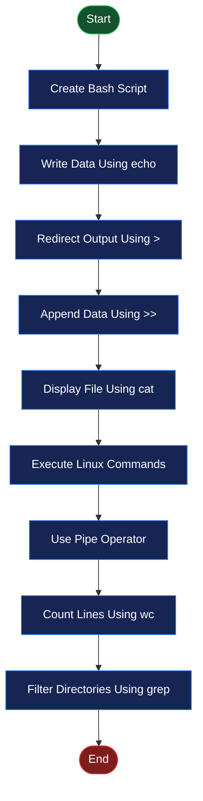
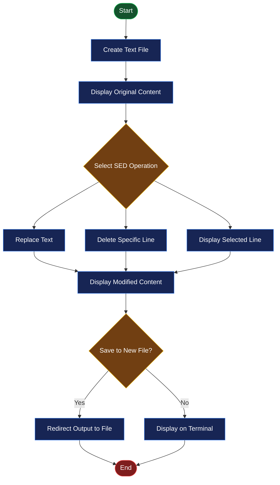

# 🖥️ EXPERIMENT NO. 03
# I/O Redirection, Pipes and SED Commands

<p align="center">
  
  
  
</p>

<p align="center">
  <b>Operating System Practical Laboratory</b><br>
  Understanding File Redirection, Pipes, Text Processing and Stream Editing in Linux.
</p>

---

## 📌 1. Aim

To study and implement **I/O Redirection, Pipes and SED (Stream Editor) Commands** using Bash shell scripts in the Ubuntu Linux operating system.

## 🎯 2. Objectives

- To understand input and output redirection in Linux.
- To learn the use of `>` and `>>` operators.
- To understand pipes (`|`) and their applications.
- To perform text searching and replacement using the `sed` command.
- To delete specific lines from a file.
- To display selected lines from a file.
- To count words using Linux pipeline commands.
- To understand file handling and text processing through shell scripting.

## 💻 3. Requirements

| Component | Description |
|---|---|
| Operating System | Ubuntu Linux |
| Virtualization | Oracle VirtualBox |
| Shell | Bash Shell |
| Language | Shell Scripting |
| Editor | GNU Nano |
| Terminal | Linux Terminal |
| Commands | echo, cat, ls, wc, grep, sed |

---

## 📚 4. Introduction / Theory

### A. I/O Redirection

I/O Redirection is a feature of Linux that allows users to change the default input and output locations of commands.

Normally, the output of a command is displayed on the terminal. Using redirection, we can store the output in a file.

**Types of I/O Redirection:**

| Operator | Description |
|---|---|
| `>` | Redirects output to a file and overwrites existing content. |
| `>>` | Appends output to the end of an existing file. |
| `<` | Takes input from a file instead of the keyboard. |

**Example:**

```bash
echo "Hello Linux" > output.txt
echo "Welcome" >> output.txt
cat output.txt
```

### B. Pipes

A pipe (`|`) is used to send the output of one command as the input of another command.

It allows multiple Linux commands to work together.

**Syntax:**

```bash
command1 | command2
```

**Example:**

```bash
ls -l | wc -l
```

This command displays the number of lines produced by `ls -l`.

### C. SED Command

SED stands for **Stream Editor**. It is a Linux command used to search, replace, delete and display text without manually opening a file.

**Common SED Operations:**

| Command | Description |
|---|---|
| `sed 's/old/new/g' file` | Replaces all occurrences of old text with new text. |
| `sed '2d' file` | Deletes the second line from the output. |
| `sed -n '2p' file` | Displays only the second line. |
| `sed 's/old/new/g' file > output.txt` | Saves modified content into another file. |

---

## ⚙️ 5. Program Implementations

### PROGRAM 1: Input and Output Redirection

**Objective:** To demonstrate output redirection using `>` and `>>` operators.

**Source Code:**

```bash
#!/bin/bash

echo "Hello, Operating System" > output.txt
echo "Welcome to Linux" >> output.txt

echo "Contents of output.txt:"
cat output.txt

echo "Program executed successfully."
```

**Explanation:**

1. `#!/bin/bash` specifies the Bash interpreter.
2. `>` creates a file or overwrites its existing content.
3. `>>` appends new content to the file.
4. `cat` displays the contents of the file.
5. The final echo statement displays the success message.

**Expected Output:**

```text
Contents of output.txt:
Hello, Operating System
Welcome to Linux
Program executed successfully.
```

---

### PROGRAM 2: Using Pipes

**Objective:** To demonstrate the use of pipes for combining Linux commands.

**Source Code:**

```bash
#!/bin/bash

echo "Displaying all files and directories:"
ls -l

echo ""
echo "Counting the number of lines:"
ls -l | wc -l

echo ""
echo "Displaying only directory names:"
ls -l | grep "^d"
```

**Explanation:**

1. `ls -l` displays files and directories in detailed format.
2. `|` sends the output of one command to another.
3. `wc -l` counts the number of lines.
4. `grep "^d"` filters lines beginning with `d`, which represent directories in the long listing.

**Expected Output (Illustrative):**

```text
Displaying all files and directories:
total 12
-rw-r--r-- 1 user user 20 output.txt
drwxr-xr-x 2 user user 4096 Documents

Counting the number of lines:
3

Displaying only directory names:
drwxr-xr-x 2 user user 4096 Documents
```

*Note: Actual output depends on the files and directories present in your working folder.*

---

### PROGRAM 3: Using SED Command

**Objective:** To replace a particular word in a file using the SED command.

**Source Code:**

```bash
#!/bin/bash

echo "Linux is easy to learn" > sample.txt

echo "Original text:"
cat sample.txt

echo ""
echo "Replacing Linux with Ubuntu:"
sed 's/Linux/Ubuntu/g' sample.txt
```

**Explanation:**

1. `echo` writes text into `sample.txt`.
2. `cat` displays the original content.
3. `sed` searches for the word `Linux`.
4. `s/Linux/Ubuntu/g` replaces every occurrence of Linux with Ubuntu.
5. The modified text is displayed on the terminal without changing the original file.

**Expected Output:**

```text
Original text:
Linux is easy to learn

Replacing Linux with Ubuntu:
Ubuntu is easy to learn
```

---

### PROGRAM 4: Save Modified Text to a New File

**Objective:** To modify text using SED and save the modified content into another file.

**Source Code:**

```bash
#!/bin/bash

echo "Operating System is an important subject" > input.txt

echo "Original file:"
cat input.txt

sed 's/Operating System/OS/g' input.txt > output.txt

echo ""
echo "Modified file:"
cat output.txt
```

**Explanation:**

1. The original text is stored in `input.txt`.
2. `cat` displays the original file content.
3. `sed` searches for the phrase `Operating System`.
4. The phrase is replaced with `OS`.
5. `>` redirects the modified content into `output.txt`.
6. `cat output.txt` displays the modified content.

**Expected Output:**

```text
Original file:
Operating System is an important subject

Modified file:
OS is an important subject
```

---

### PROGRAM 5: Delete a Line Using SED

**Objective:** To delete a particular line from a file using the SED command.

**Source Code:**

```bash
#!/bin/bash

cat > sample.txt <<EOF
First line
Second line
Third line
Fourth line
EOF

echo "Original file:"
cat sample.txt

echo ""
echo "After deleting the second line:"
sed '2d' sample.txt
```

**Explanation:**

1. `cat > sample.txt` creates a file.
2. The `EOF` delimiter marks the end of the input.
3. `cat` displays all four lines.
4. `sed '2d'` deletes the second line from the displayed output.
5. The original file remains unchanged.

**Expected Output:**

```text
Original file:
First line
Second line
Third line
Fourth line

After deleting the second line:
First line
Third line
Fourth line
```

---

### PROGRAM 6: Display Selected Lines Using SED

**Objective:** To display a particular line from a file using SED.

**Source Code:**

```bash
#!/bin/bash

echo "First line
Second line
Third line
Fourth line" > lines.txt

echo "Displaying the second line:"
sed -n '2p' lines.txt
```

**Explanation:**

1. The `echo` command creates a file named `lines.txt`.
2. The file contains four lines of text.
3. `-n` suppresses automatic printing.
4. `2p` prints only the second line.
5. The selected line is displayed on the terminal.

**Expected Output:**

```text
Displaying the second line:
Second line
```

---

### PROGRAM 7: Count Words Using Pipe

**Objective:** To count the total number of words in a text file using a pipe.

**Source Code:**

```bash
#!/bin/bash

echo "Linux is easy to learn" > words.txt

echo "Original text:"
cat words.txt

echo ""
echo "Number of words:"
cat words.txt | wc -w
```

**Explanation:**

1. The `echo` command writes text into `words.txt`.
2. `cat` displays the original text.
3. The pipe (`|`) sends the file content to the next command.
4. `wc -w` counts the total number of words.
5. The result is displayed on the terminal.

**Expected Output:**

```text
Original text:
Linux is easy to learn

Number of words:
5
```

---

## 🔄 6. Flowcharts

### Flowchart 1: I/O Redirection and Pipes



### Flowchart 2: SED Command Operations



---

## ▶️ 7. Execution Procedure in Ubuntu Linux

Follow these steps to execute the programs in Ubuntu using the Linux Terminal.

**Step 1: Open Terminal**

Press `Ctrl + Alt + T` to open the Ubuntu terminal.

**Step 2: Create a Working Directory**

```bash
mkdir Experiment_03
cd Experiment_03
```

**Step 3: Create a Bash Script**

For example, to execute Program 1:

```bash
nano program1.sh
```

Paste the Program 1 source code into the editor.

**Step 4: Save the File**

- Press `Ctrl + O` to save.
- Press `Enter` to confirm.
- Press `Ctrl + X` to exit Nano.

**Step 5: Give Execution Permission**

```bash
chmod +x program1.sh
```

**Step 6: Execute the Script**

```bash
./program1.sh
```

**Step 7: Repeat for Other Programs**

Create separate files for the remaining programs:

```text
program1.sh
program2.sh
program3.sh
program4.sh
program5.sh
program6.sh
program7.sh
```

Execute each program using:

```bash
chmod +x program2.sh
./program2.sh
```

Repeat the same process for all seven programs.

---

## 📸 8. Practical Screenshots

The following screenshots provide visual proof of successful execution in the Ubuntu Linux terminal.

### Screenshot 1: I/O Redirection and Pipes

**Description:** Demonstration of output redirection, appending data, listing files, counting lines and filtering directories.

<p align="center">
  
</p>

<p align="center">
  <i>Figure 1: Execution of I/O Redirection and Pipe Commands in Ubuntu Terminal.</i>
</p>

### Screenshot 2: SED Commands and Word Counting

**Description:** Demonstration of text replacement, saving modified text, deleting lines, displaying selected lines and counting words.

<p align="center">
  
</p>

<p align="center">
  <i>Figure 2: Execution of SED and Word Counting Commands in Ubuntu Terminal.</i>
</p>

**Note:** Create a folder named `screenshots` in your repository and upload your actual terminal screenshots using the exact filenames shown above.

---

## 📂 9. Project Directory Structure

```text
Experiment-03/
│
├── README.md
│
├── program1.sh
├── program2.sh
├── program3.sh
├── program4.sh
├── program5.sh
├── program6.sh
├── program7.sh
│
└── screenshots/
    ├── experiment3-io-pipes.png
    └── experiment3-sed.png
```

---

## 📖 10. Important Commands Summary

| Command | Purpose |
|---|---|
| `echo` | Displays or writes text. |
| `cat` | Creates or displays file content. |
| `>` | Redirects and overwrites output. |
| `>>` | Appends output to a file. |
| `|` | Connects two commands using a pipe. |
| `ls -l` | Displays detailed file information. |
| `wc -l` | Counts lines. |
| `wc -w` | Counts words. |
| `grep "^d"` | Filters directory entries from long listings. |
| `sed 's/a/b/g'` | Replaces text. |
| `sed '2d'` | Deletes the second line from output. |
| `sed -n '2p'` | Displays the second line. |
| `chmod +x` | Gives execution permission. |

---

## 🎓 11. Learning Outcomes

After completing this experiment, the following concepts were understood:

- Working with input and output redirection in Linux.
- Using `>` and `>>` to create and append file content.
- Combining multiple commands using pipes.
- Filtering command output using `grep`.
- Counting lines and words using `wc`.
- Searching and replacing text using SED.
- Deleting specific lines and displaying selected lines.
- Saving modified text into a new file.
- Creating and executing Bash shell scripts in Ubuntu.

---

## ✅ 12. Result

I/O Redirection, Pipes and SED commands were successfully studied and demonstrated using Bash shell scripts in the Ubuntu Linux environment.

The experiment helped in understanding file handling, command chaining and text processing operations in the Linux operating system.

---

<p align="center">
  <b>💻 OPERATING SYSTEM PRACTICAL</b><br>
  <i>Learning Linux Through Practical Implementation</i>
</p>

<p align="center">
  ⭐ If you find this repository useful, consider giving it a star!
</p>


