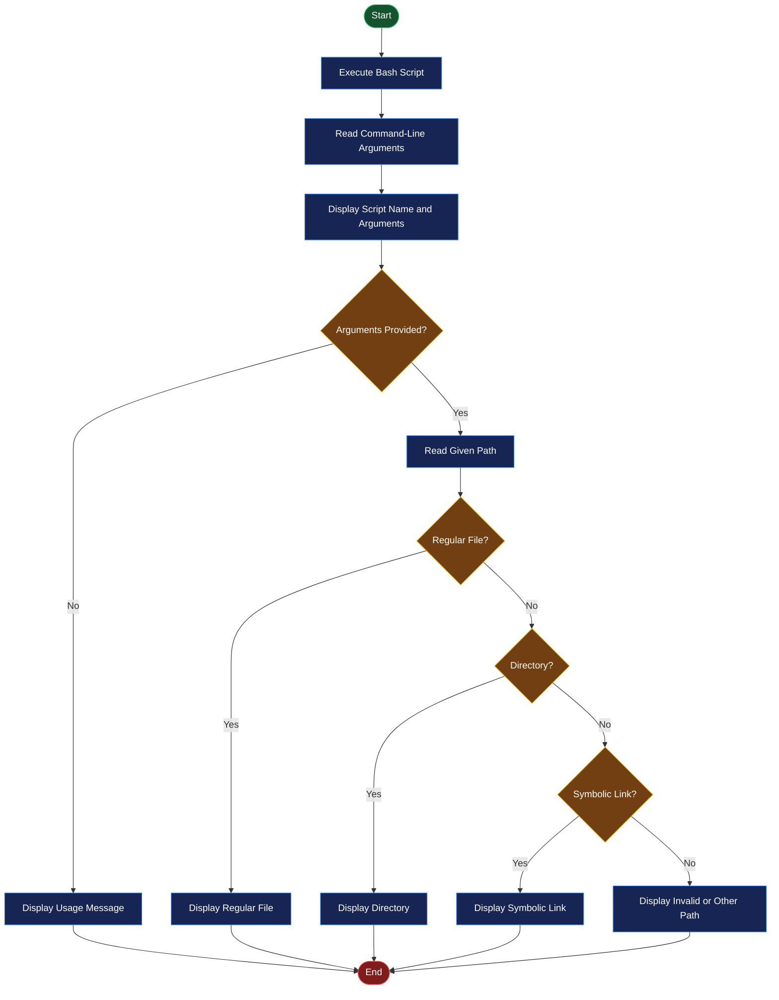
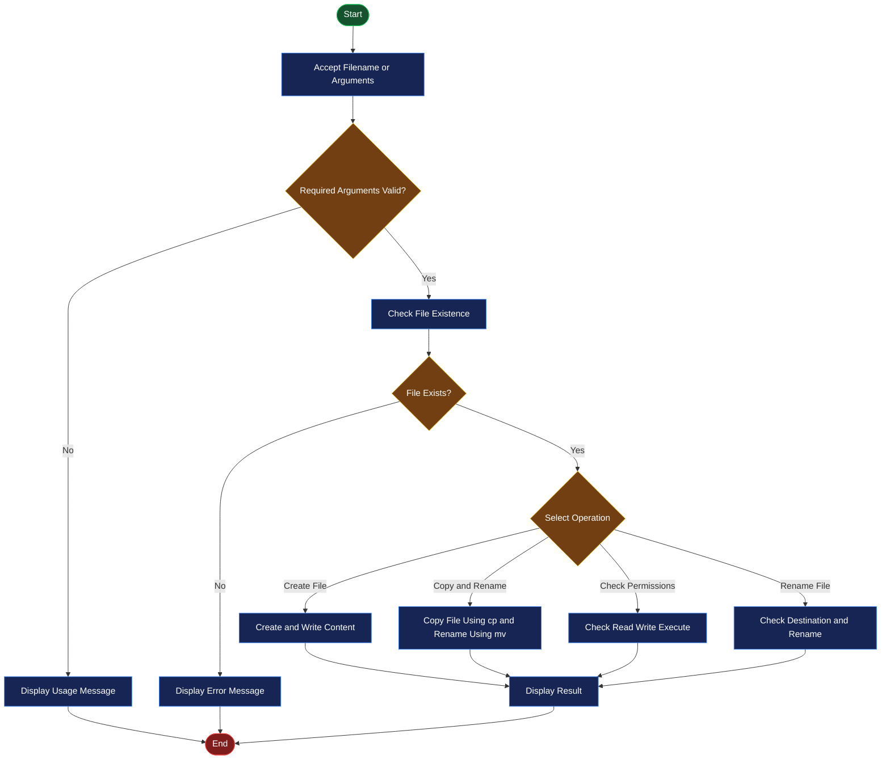

# 🖥️ EXPERIMENT NO. 05
# SHELL SCRIPTING WITH COMMAND-LINE ARGUMENTS AND FILE MANIPULATION

<p align="center">
  
  
  
</p>

<p align="center">
  <b>Operating System Practical Laboratory</b><br>
  Understanding Command-Line Arguments, File Identification, File Permissions and File Manipulation Using Bash Shell Scripting.
</p>

---

## 📌 1. Aim

To study and implement **Shell Scripting with Command-Line Arguments and File Manipulation** using Bash shell scripts in the Ubuntu Linux operating system.

## 🎯 2. Objectives

- To understand the basics of shell scripting in Linux.
- To learn how to pass command-line arguments to shell scripts.
- To display script names and argument values.
- To identify whether a given path is a file, directory or symbolic link.
- To create and manipulate files using shell commands.
- To copy and rename files using `cp` and `mv`.
- To check file existence and file permissions.
- To rename files using command-line arguments.
- To understand conditional statements and file test operators in Bash.

## 💻 3. Requirements

| Component | Description |
|---|---|
| Operating System | Ubuntu Linux |
| Virtualization | Oracle VirtualBox |
| Shell | Bash Shell |
| Language | Shell Scripting |
| Editor | GNU Nano |
| Terminal | Linux Terminal |
| Commands | echo, touch, cat, cp, mv, chmod |
| Operators | File Test Operators and Conditional Statements |

---

## 📚 4. Introduction / Theory

### A. Shell Scripting

Shell scripting is a method of writing a series of Linux commands in a file and executing them together using a shell interpreter.

It helps automate repetitive tasks and perform file management operations.

A Bash script generally starts with:

```bash
#!/bin/bash
```

This line specifies that the script should be executed using the Bash shell.

### B. Command-Line Arguments

Command-line arguments are values passed to a shell script when it is executed from the terminal.

They allow users to provide input without modifying the script.

**Important Special Variables:**

| Variable | Description |
|---|---|
| `$0` | Name or path used to execute the script. |
| `$1` | First command-line argument. |
| `$2` | Second command-line argument. |
| `$#` | Total number of arguments. |
| `$@` | All command-line arguments. |
| `$!` | PID of the last background process. |
| `$$` | PID of the current shell. |

**Example:**

```bash
./script.sh Linux Ubuntu
```

Here:
- `$0` = `./script.sh`
- `$1` = `Linux`
- `$2` = `Ubuntu`
- `$#` = `2`
- `$@` = `Linux Ubuntu`

### C. Conditional Statements in Bash

Conditional statements are used to execute commands based on specific conditions.

**Syntax:**

```bash
if [ condition ]; then
    commands
else
    commands
fi
```

The `if`, `elif` and `else` statements help make decisions in shell scripts.

### D. File Test Operators

File test operators are used to check the type, existence and permissions of files.

| Operator | Description |
|---|---|
| `-f` | Checks whether the path is a regular file. |
| `-d` | Checks whether the path is a directory. |
| `-L` | Checks whether the path is a symbolic link. |
| `-e` | Checks whether a path exists. |
| `-r` | Checks whether a path is readable. |
| `-w` | Checks whether a path is writable. |
| `-x` | Checks whether a path is executable. |

### E. File Manipulation Commands

Linux provides several commands for creating, displaying, copying and renaming files.

| Command | Description |
|---|---|
| `touch` | Creates an empty file or updates its timestamp. |
| `cat` | Displays file contents. |
| `echo` | Displays or writes text. |
| `cp` | Copies files. |
| `mv` | Moves or renames files. |
| `rm` | Removes files. |
| `chmod` | Changes file permissions. |

---

## ⚙️ 5. Program Implementations

### PROGRAM 1: Display Command-Line Arguments

**Objective:** To display the script name, command-line arguments and total number of arguments passed to a Bash script.

**Source Code:**

```bash
#!/bin/bash

echo "Script Name: $0"
echo "First Argument: $1"
echo "Second Argument: $2"
echo "Total Number of Arguments: $#"
echo "All Arguments: $@"
```

**Explanation:**

1. `#!/bin/bash` specifies the Bash interpreter.
2. `$0` displays the name or path of the script.
3. `$1` displays the first argument.
4. `$2` displays the second argument.
5. `$#` displays the total number of arguments.
6. `$@` displays all arguments passed to the script.

**Execution Command:**

```bash
./program1.sh Linux Ubuntu
```

**Expected Output:**

```text
Script Name: ./program1.sh
First Argument: Linux
Second Argument: Ubuntu
Total Number of Arguments: 2
All Arguments: Linux Ubuntu
```

---

### PROGRAM 2: Identify File or Directory

**Objective:** To identify whether a given path is a regular file, directory, symbolic link or another type of path.

**Source Code:**

```bash
#!/bin/bash

if [ $# -eq 0 ]; then
    echo "Usage: $0 <path>"
    exit 1
fi

path="$1"

if [ -f "$path" ]; then
    echo "$path is a regular file."
elif [ -d "$path" ]; then
    echo "$path is a directory."
elif [ -L "$path" ]; then
    echo "$path is a symbolic link."
else
    echo "$path does not exist or is another type of path."
fi
```

**Explanation:**

1. `$# -eq 0` checks whether no argument has been provided.
2. `exit 1` terminates the script with an error status.
3. `$1` stores the path supplied by the user.
4. `-f` checks whether the path is a regular file.
5. `-d` checks whether the path is a directory.
6. `-L` checks whether the path is a symbolic link.
7. If none of the conditions is satisfied, the script displays an appropriate message.

**Execution Commands:**

```bash
./program2.sh sample.txt
```

```bash
./program2.sh Documents
```

**Expected Output:**

For a regular file:

```text
sample.txt is a regular file.
```

For a directory:

```text
Documents is a directory.
```

For a symbolic link:

```text
mylink is a symbolic link.
```

---

### PROGRAM 3: Create and Manipulate a File

**Objective:** To create a file, write content into it, append additional text and display its contents.

**Source Code:**

```bash
#!/bin/bash

filename="sample.txt"

echo "Creating a file..."
touch "$filename"

echo "Hello, Linux!" > "$filename"
echo "This is a shell scripting practical." >> "$filename"

echo "File contents:"
cat "$filename"
```

**Explanation:**

1. `filename="sample.txt"` stores the filename in a variable.
2. `touch` creates the file.
3. `>` writes the first line and overwrites existing content.
4. `>>` appends the second line to the file.
5. `cat` displays the complete file contents.

**Expected Output:**

```text
Creating a file...
File contents:
Hello, Linux!
This is a shell scripting practical.
```

---

### PROGRAM 4: Copy and Rename a File

**Objective:** To copy an existing file and rename the copied file using Linux commands.

**Source Code:**

```bash
#!/bin/bash

source="sample.txt"
destination="backup.txt"

if [ -f "$source" ]; then
    cp "$source" "$destination"
    echo "File copied to $destination."

    mv "$destination" "renamed.txt"
    echo "File renamed to renamed.txt."
else
    echo "Source file does not exist."
fi
```

**Explanation:**

1. `source` stores the original filename.
2. `destination` stores the backup filename.
3. `-f` checks whether the source file exists as a regular file.
4. `cp` copies the original file into `backup.txt`.
5. `mv` renames `backup.txt` to `renamed.txt`.
6. If the source file does not exist, an error message is displayed.

**Expected Output:**

```text
File copied to backup.txt.
File renamed to renamed.txt.
```

**Resulting Files:**

```text
sample.txt
renamed.txt
```

---

### PROGRAM 5: Display File Information

**Objective:** To check whether a file or path exists and display its read, write and execute permissions.

**Source Code:**

```bash
#!/bin/bash

if [ $# -eq 0 ]; then
    echo "Usage: $0 <filename>"
    exit 1
fi

filename="$1"

if [ -e "$filename" ]; then
    echo "File or path exists."

    if [ -r "$filename" ]; then
        echo "Readable: Yes"
    else
        echo "Readable: No"
    fi

    if [ -w "$filename" ]; then
        echo "Writable: Yes"
    else
        echo "Writable: No"
    fi

    if [ -x "$filename" ]; then
        echo "Executable: Yes"
    else
        echo "Executable: No"
    fi
else
    echo "File or path does not exist."
fi
```

**Explanation:**

1. `$# -eq 0` checks whether the user has provided a filename.
2. `$1` stores the filename supplied by the user.
3. `-e` checks whether the specified path exists.
4. `-r` checks read permission.
5. `-w` checks write permission.
6. `-x` checks execute permission.
7. The `if-else` statements display the permission status.

**Execution Command:**

```bash
./program5.sh sample.txt
```

**Expected Output (Illustrative):**

```text
File or path exists.
Readable: Yes
Writable: Yes
Executable: No
```

*Note: Permission results depend on the file permissions and the current user's access.*

---

### PROGRAM 6: Rename a File Using Command-Line Arguments

**Objective:** To rename a file by accepting the old and new filenames as command-line arguments.

**Source Code:**

```bash
#!/bin/bash

if [ $# -ne 2 ]; then
    echo "Usage: $0 <old_filename> <new_filename>"
    exit 1
fi

oldname="$1"
newname="$2"

if [ -f "$oldname" ]; then
    if [ -e "$newname" ]; then
        echo "Error: Destination already exists."
        exit 1
    fi

    mv -- "$oldname" "$newname"
    echo "File renamed successfully."
else
    echo "Error: Source file does not exist."
fi
```

**Explanation:**

1. `$# -ne 2` checks whether exactly two arguments have been provided.
2. `$1` stores the old filename.
3. `$2` stores the new filename.
4. `-f` checks whether the original file exists.
5. `-e` checks whether the destination path already exists.
6. `mv --` renames the file. The `--` marks the end of command options.
7. If the destination already exists, the script stops to avoid overwriting it.
8. If the source file does not exist, an error message is displayed.

**Execution Command:**

```bash
./program6.sh old.txt new.txt
```

**Expected Output:**

```text
File renamed successfully.
```

**Example:**

Before execution:

```text
old.txt
```

After execution:

```text
new.txt
```

---

## 🔄 6. Flowcharts

### Flowchart 1: Command-Line Arguments and File Identification



### Flowchart 2: File Manipulation and Permission Checking



---

## ▶️ 7. Execution Procedure in Ubuntu Linux

Follow these steps to create and execute the six Bash programs in Ubuntu.

### Step 1: Open Terminal

Press `Ctrl + Alt + T` to open the Ubuntu terminal.

### Step 2: Create a Working Directory

```bash
mkdir Experiment_05
cd Experiment_05
```

### Step 3: Create a Bash Script

For example, to create Program 1:

```bash
nano program1.sh
```

Paste the Program 1 source code into the editor.

### Step 4: Save the File

- Press `Ctrl + O` to save.
- Press `Enter` to confirm the filename.
- Press `Ctrl + X` to exit Nano.

### Step 5: Give Execution Permission

```bash
chmod +x program1.sh
```

### Step 6: Execute the Script

For Program 1:

```bash
./program1.sh Linux Ubuntu
```

For Program 2:

```bash
./program2.sh sample.txt
```

For Program 3:

```bash
./program3.sh
```

For Program 4:

```bash
./program4.sh
```

For Program 5:

```bash
./program5.sh sample.txt
```

For Program 6:

```bash
./program6.sh old.txt new.txt
```

### Step 7: Verify the Created Files

Use the following command to display files in the current directory:

```bash
ls -l
```

**Note:** Program 2, Program 5 and Program 6 require command-line arguments. Program 4 requires `sample.txt` to exist, so execute Program 3 before Program 4.

---

## 📸 8. Practical Screenshots

The following screenshots provide visual proof of successful execution in the Ubuntu Linux terminal.

### Screenshot 1: Command-Line Arguments and File Identification

**Description:** Demonstration of command-line arguments, script name, total arguments and identification of files, directories and symbolic links.

<p align="center">
  
</p>

<p align="center">
  <i>Figure 1: Execution of Command-Line Arguments and File Identification Programs.</i>
</p>

### Screenshot 2: File Manipulation and Permission Checking

**Description:** Demonstration of file creation, copying, renaming, file information and permission checking.

<p align="center">
  
</p>

<p align="center">
  <i>Figure 2: Execution of File Manipulation and File Permission Programs.</i>
</p>

**Note:** Create a folder named `screenshots` in your repository and upload your actual Ubuntu terminal screenshots using the exact filenames shown above.

---

## 📂 9. Project Directory Structure

```text
Experiment-05/
│
├── README.md
│
├── program1.sh
├── program2.sh
├── program3.sh
├── program4.sh
├── program5.sh
├── program6.sh
│
└── screenshots/
    ├── experiment5-command-line-arguments.png
    └── experiment5-file-manipulation.png
```

---

## 📖 10. Important Commands and Operators Summary

| Command / Operator | Purpose |
|---|---|
| `#!/bin/bash` | Specifies the Bash interpreter. |
| `$0` | Displays script name or execution path. |
| `$1` | Accesses the first argument. |
| `$2` | Accesses the second argument. |
| `$#` | Counts the total arguments. |
| `$@` | Displays all arguments. |
| `if` | Executes commands based on a condition. |
| `-f` | Checks for a regular file. |
| `-d` | Checks for a directory. |
| `-L` | Checks for a symbolic link. |
| `-e` | Checks whether a path exists. |
| `-r` | Checks read permission. |
| `-w` | Checks write permission. |
| `-x` | Checks execute permission. |
| `touch` | Creates a file. |
| `cat` | Displays file contents. |
| `cp` | Copies a file. |
| `mv` | Moves or renames a file. |
| `chmod +x` | Gives execution permission. |
| `exit 1` | Terminates a script with an error status. |

---

## 🎓 11. Learning Outcomes

After completing this experiment, the following concepts were understood:

- Writing and executing Bash shell scripts.
- Passing command-line arguments to scripts.
- Using special shell variables such as `$0`, `$1`, `$2`, `$#` and `$@`.
- Identifying regular files, directories and symbolic links.
- Creating files and writing or appending content.
- Copying and renaming files using Linux commands.
- Checking file existence and permissions.
- Using conditional statements for decision-making.
- Renaming files dynamically through command-line arguments.
- Automating basic file management operations using shell scripting.

---

## ✅ 12. Result

Shell scripting with command-line arguments, file identification, file manipulation and filename renaming was successfully studied and demonstrated using Bash shell scripts in the Ubuntu Linux environment.

The experiment helped in understanding command-line argument handling, conditional statements, file test operators, file permissions and basic file management operations in Linux.

---

<p align="center">
  <b>💻 OPERATING SYSTEM PRACTICAL</b><br>
  <i>Learning Linux Through Practical Implementation</i>
</p>

<p align="center">
  ⭐ If you find this repository useful, consider giving it a star!
</p>
