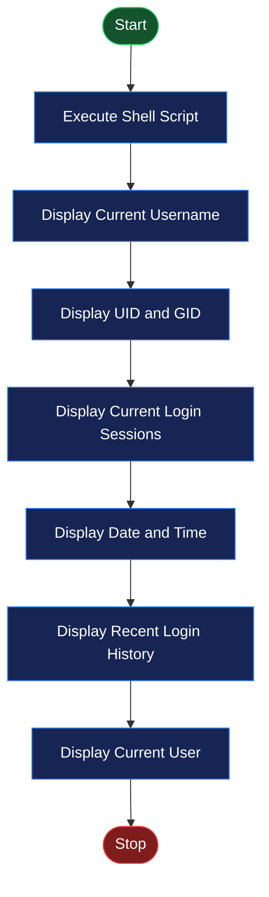
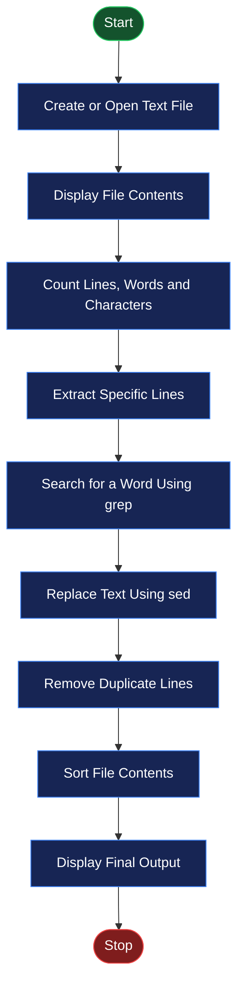

# 🖥️ EXPERIMENT NO. 6
# USER INFORMATION, LINE EXTRACTION AND TEXT PROCESSING IN LINUX

<p align="center">
  
  
  
  
</p>

---

## 📌 AIM

To study and implement Linux shell commands for displaying user information, viewing login history, counting lines, words and characters, extracting specific lines, searching text, replacing words, displaying unique lines, and sorting file contents.

## 🎯 OBJECTIVES

- To display the current username and user identification details.
- To understand user login sessions and login history.
- To count lines, words, and characters in a text file.
- To extract specific lines using the `sed` command.
- To search for specific words using `grep`.
- To replace text using `sed`.
- To remove duplicate lines using `sort -u`.
- To sort file contents alphabetically using `sort`.

## 🛠️ SOFTWARE REQUIREMENTS

| Component | Description |
|---|---|
| Operating System | Ubuntu Linux |
| Virtualization Software | Oracle VirtualBox |
| Shell | Bash |
| Editor | GNU Nano |
| Terminal | Linux Terminal |
| Commands Used | `whoami`, `id`, `who`, `date`, `last`, `wc`, `sed`, `grep`, `sort` |

---

## 📖 THEORY

Linux provides several commands to obtain user information and process text files. These commands are useful for system administration, file management, and shell scripting.

### 1. User Information Commands

| Command | Description |
|---|---|
| `whoami` | Displays the current username. |
| `id` | Displays user ID (UID) and group ID (GID). |
| `who` | Displays currently logged-in users. |
| `date` | Displays the current date and time. |
| `last` | Displays previous login records. |

### 2. Text Processing Commands

| Command | Description |
|---|---|
| `cat` | Displays file contents. |
| `wc -l` | Counts the number of lines. |
| `wc -w` | Counts the number of words. |
| `wc -m` | Counts the number of characters. |
| `sed` | Extracts or modifies text in a file. |
| `grep` | Searches for a specified word or pattern. |
| `sort` | Sorts lines alphabetically. |
| `sort -u` | Sorts lines and removes duplicates. |

### 3. Important Command Syntax

**Counting lines, words, and characters:**

```bash
wc -l filename
wc -w filename
wc -m filename
```

**Extracting a specific line:**

```bash
sed -n '1p' filename
```

**Searching for a word:**

```bash
grep -n "word" filename
```

**Replacing text:**

```bash
sed 's/old/new/g' filename
```

**Sorting and removing duplicate lines:**

```bash
sort filename
sort -u filename
```

---

# 💻 PROGRAM IMPLEMENTATION

## PROGRAM 1: DISPLAY CURRENT USER INFORMATION

### Objective
To display the current username, user ID, group ID, active login sessions, and current date and time.

### Source Code

```bash
#!/bin/bash

echo "Current Username:"
whoami

echo ""
echo "User ID and Group ID:"
id

echo ""
echo "Current Login Sessions:"
who

echo ""
echo "Current Date and Time:"
date
```

### Explanation

1. `#!/bin/bash` specifies that the script should run using the Bash shell.
2. `echo` displays the given message.
3. `whoami` displays the username of the currently logged-in user.
4. `id` displays the UID and GID of the user.
5. `who` displays currently logged-in sessions.
6. `date` displays the system's current date and time.

### Execution

```bash
nano program1.sh
chmod +x program1.sh
./program1.sh
```

### Expected Output

```text
Current Username:
student

User ID and Group ID:
uid=1000(student) gid=1000(student) groups=1000(student)

Current Login Sessions:
student  tty2  ...

Current Date and Time:
Mon Nov  3 11:00:00 IST 2026
```

*Note: Username, UID, login sessions, and date/time will vary depending on your Ubuntu system.*

---

## PROGRAM 2: DISPLAY USER LOGIN HISTORY

### Objective
To display the five most recent login records and the current username.

### Source Code

```bash
#!/bin/bash

echo "Recent Login History:"
last -n 5

echo ""
echo "Current User:"
whoami
```

### Explanation

1. `#!/bin/bash` specifies the Bash interpreter.
2. `echo` displays the heading.
3. `last -n 5` displays the five most recent login records.
4. `whoami` displays the current username.

### Execution

```bash
nano program2.sh
chmod +x program2.sh
./program2.sh
```

### Expected Output

```text
Recent Login History:
student  tty2  ...
student  tty2  ...
student  tty2  ...

Current User:
student
```

*Note: Login history depends on the login records available on the system.*

---

## PROGRAM 3: COUNT LINES, WORDS AND CHARACTERS

### Objective
To create a text file and count its total number of lines, words, and characters using the `wc` command.

### Source Code

```bash
#!/bin/bash

filename="sample.txt"

cat > "$filename" <<EOF
Linux is an operating system.
Shell scripting is useful.
Text processing is important.
EOF

echo "File Contents:"
cat "$filename"

echo ""
echo "Number of Lines:"
wc -l < "$filename"

echo "Number of Words:"
wc -w < "$filename"

echo "Number of Characters:"
wc -m < "$filename"
```

### Explanation

1. `filename="sample.txt"` stores the filename in a variable.
2. `cat > "$filename" <<EOF` creates a file and writes the given text into it.
3. `cat "$filename"` displays the contents of the file.
4. `wc -l` counts the total number of lines.
5. `wc -w` counts the total number of words.
6. `wc -m` counts the total number of characters.

### Execution

```bash
nano program3.sh
chmod +x program3.sh
./program3.sh
```

### Expected Output

```text
File Contents:
Linux is an operating system.
Shell scripting is useful.
Text processing is important.

Number of Lines:
3

Number of Words:
13

Number of Characters:
86
```

*Note: Character count includes spaces and newline characters. The exact count can depend on the file's newline format.*

---

## PROGRAM 4: EXTRACT A SPECIFIC LINE

### Objective
To extract and display the first, second, and third lines from a text file using the `sed` command.

### Source Code

```bash
#!/bin/bash

filename="sample.txt"

echo "First line:"
sed -n '1p' "$filename"

echo ""
echo "Second line:"
sed -n '2p' "$filename"

echo ""
echo "Third line:"
sed -n '3p' "$filename"
```

### Explanation

1. `filename="sample.txt"` stores the name of the text file.
2. `sed` is a stream editor used to process text.
3. `-n` prevents automatic printing of every line.
4. `'1p'` prints the first line.
5. `'2p'` prints the second line.
6. `'3p'` prints the third line.

### Execution

```bash
nano program4.sh
chmod +x program4.sh
./program4.sh
```

### Expected Output

```text
First line:
Linux is an operating system.

Second line:
Shell scripting is useful.

Third line:
Text processing is important.
```

---

## PROGRAM 5: SEARCH FOR A WORD IN A FILE

### Objective
To search for a specific word in a text file using the `grep` command.

### Source Code

```bash
#!/bin/bash

filename="sample.txt"
search_word="Linux"

echo "Searching for the word: $search_word"

if grep -n "$search_word" "$filename"; then
    echo "Search completed."
else
    echo "Word not found."
fi
```

### Explanation

1. `filename="sample.txt"` stores the filename.
2. `search_word="Linux"` stores the word to be searched.
3. `grep` searches for the specified word in the file.
4. `-n` displays the line number where the matching text is found.
5. `if` checks whether the search is successful.
6. If the word is found, the script displays `Search completed.`
7. Otherwise, it displays `Word not found.`

### Execution

```bash
nano program5.sh
chmod +x program5.sh
./program5.sh
```

### Expected Output

```text
Searching for the word: Linux
1:Linux is an operating system.
Search completed.
```

---

## PROGRAM 6: REPLACE TEXT USING SED

### Objective
To replace a particular word in a text file using the `sed` command without modifying the original file.

### Source Code

```bash
#!/bin/bash

filename="sample.txt"

echo "Original Text:"
cat "$filename"

echo ""
echo "Modified Text:"
sed 's/Linux/Ubuntu/g' "$filename"
```

### Explanation

1. `filename="sample.txt"` stores the filename.
2. `cat "$filename"` displays the original file contents.
3. `sed` performs text replacement.
4. `s/Linux/Ubuntu/g` replaces every occurrence of `Linux` with `Ubuntu`.
5. `g` stands for global replacement, meaning all matching occurrences on each line are replaced.
6. The modified text is displayed without changing the original file.

### Execution

```bash
nano program6.sh
chmod +x program6.sh
./program6.sh
```

### Expected Output

```text
Original Text:
Linux is an operating system.
Shell scripting is useful.
Text processing is important.

Modified Text:
Ubuntu is an operating system.
Shell scripting is useful.
Text processing is important.
```

---

## PROGRAM 7: DISPLAY UNIQUE LINES

### Objective
To remove duplicate lines from a text file and display only unique lines using the `sort -u` command.

### Source Code

```bash
#!/bin/bash

cat > duplicate.txt <<EOF
Apple
Banana
Apple
Mango
Banana
Orange
EOF

echo "Original Lines:"
cat duplicate.txt

echo ""
echo "Unique Lines:"
sort -u duplicate.txt
```

### Explanation

1. `cat > duplicate.txt <<EOF` creates a file containing fruit names.
2. `cat duplicate.txt` displays all original lines, including duplicates.
3. `sort -u duplicate.txt` sorts the lines alphabetically.
4. The `-u` option removes duplicate lines.
5. The resulting output contains only unique entries.

### Execution

```bash
nano program7.sh
chmod +x program7.sh
./program7.sh
```

### Expected Output

```text
Original Lines:
Apple
Banana
Apple
Mango
Banana
Orange

Unique Lines:
Apple
Banana
Mango
Orange
```

---

## PROGRAM 8: SORT TEXT FILE CONTENTS

### Objective
To create a text file containing fruit names and sort its contents alphabetically using the `sort` command.

### Source Code

```bash
#!/bin/bash

filename="fruits.txt"

cat > "$filename" <<EOF
Mango
Apple
Orange
Banana
EOF

echo "Original File:"
cat "$filename"

echo ""
echo "Sorted File:"
sort "$filename"
```

### Explanation

1. `filename="fruits.txt"` stores the filename.
2. `cat > "$filename" <<EOF` creates the file and writes fruit names into it.
3. `cat "$filename"` displays the original contents.
4. `sort "$filename"` arranges the lines in alphabetical order.
5. The sorted contents are displayed on the terminal.

### Execution

```bash
nano program8.sh
chmod +x program8.sh
./program8.sh
```

### Expected Output

```text
Original File:
Mango
Apple
Orange
Banana

Sorted File:
Apple
Banana
Mango
Orange
```

---

# 🔄 FLOWCHARTS

## Flowchart 1: User Information and Login History



## Flowchart 2: Text Processing Operations



---

# ▶️ EXECUTION PROCEDURE IN UBUNTU

Follow these steps to execute the programs in Ubuntu Linux using Oracle VirtualBox.

### Step 1: Open Ubuntu Terminal

Press:

```text
Ctrl + Alt + T
```

### Step 2: Create the Experiment Directory

```bash
mkdir Experiment-06
cd Experiment-06
```

### Step 3: Create the Shell Script Files

Create each program using Nano:

```bash
nano program1.sh
nano program2.sh
nano program3.sh
nano program4.sh
nano program5.sh
nano program6.sh
nano program7.sh
nano program8.sh
```

Paste the corresponding program code into each file.

### Step 4: Save the Files

In Nano:

- Press `Ctrl + O` to save.
- Press `Enter` to confirm.
- Press `Ctrl + X` to exit.

### Step 5: Give Execution Permission

```bash
chmod +x program1.sh program2.sh program3.sh program4.sh program5.sh program6.sh program7.sh program8.sh
```

### Step 6: Execute the Programs

Run each program separately:

```bash
./program1.sh
./program2.sh
./program3.sh
./program4.sh
./program5.sh
./program6.sh
./program7.sh
./program8.sh
```

### Step 7: Verify Generated Files

```bash
ls -l
```

The scripts automatically create the following text files:

- `sample.txt`
- `duplicate.txt`
- `fruits.txt`

---

# 📸 OUTPUT SCREENSHOTS

Add your actual Ubuntu terminal screenshots in the `screenshots` folder.

### Screenshot 1: User Information and Login History

This screenshot should show the execution and output of:

- Program 1 – Display Current User Information
- Program 2 – Display User Login History


### Screenshot 2: Text Processing Operations

This screenshot should show the execution and output of:

- Program 3 – Count Lines, Words and Characters
- Program 4 – Extract a Specific Line
- Program 5 – Search for a Word
- Program 6 – Replace Text Using SED
- Program 7 – Display Unique Lines
- Program 8 – Sort Text File Contents


> **Important:** Save your actual terminal screenshots using the exact filenames shown above. Upload them to the `screenshots` folder in your GitHub repository so that the images appear in the README.

---

# 📂 PROJECT DIRECTORY STRUCTURE

```text
Experiment-06/
│
├── README.md
│
├── program1.sh
├── program2.sh
├── program3.sh
├── program4.sh
├── program5.sh
├── program6.sh
├── program7.sh
├── program8.sh
│
├── sample.txt
├── duplicate.txt
├── fruits.txt
│
└── screenshots/
    ├── experiment6-user-information.png
    └── experiment6-text-processing.png
```

---

# 📚 IMPORTANT COMMANDS SUMMARY

| Command | Purpose |
|---|---|
| `whoami` | Displays the current username. |
| `id` | Displays user and group identification. |
| `who` | Displays active login sessions. |
| `date` | Displays the current date and time. |
| `last -n 5` | Displays the five most recent login records. |
| `cat` | Creates or displays file contents. |
| `wc -l` | Counts lines. |
| `wc -w` | Counts words. |
| `wc -m` | Counts characters. |
| `sed -n '1p'` | Extracts the first line. |
| `grep -n` | Searches text and displays line numbers. |
| `sed 's/old/new/g'` | Replaces matching text. |
| `sort -u` | Sorts lines and removes duplicates. |
| `sort` | Sorts file contents alphabetically. |
| `chmod +x` | Gives execution permission to a script. |

---

# 🎓 LEARNING OUTCOMES

After completing this experiment, the following concepts were understood:

- How to obtain current user information in Linux.
- How to identify UID and GID using the `id` command.
- How to view active login sessions and previous login history.
- How to count lines, words, and characters in a file.
- How to extract specific lines using `sed`.
- How to search for text using `grep`.
- How to replace words using the `sed` command.
- How to remove duplicate lines using `sort -u`.
- How to arrange text file contents alphabetically using `sort`.
- How to write and execute Bash shell scripts in Ubuntu Linux.

---

# ✅ RESULT

User information commands, login history commands, line extraction, text searching, word counting, character counting, sorting, displaying unique lines, and text replacement using Linux shell commands were successfully studied and implemented.

---

<p align="center">
  <b>🖥️ OPERATING SYSTEM PRACTICAL</b>
  <br/>
  <i>Experiment No. 06 — Linux Shell Scripting and Text Processing</i>
  <br/><br/>
  ⭐ If you find this repository useful, consider giving it a star!
</p>
