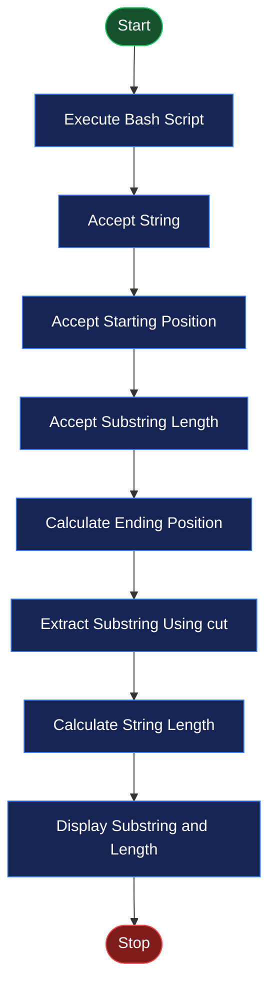
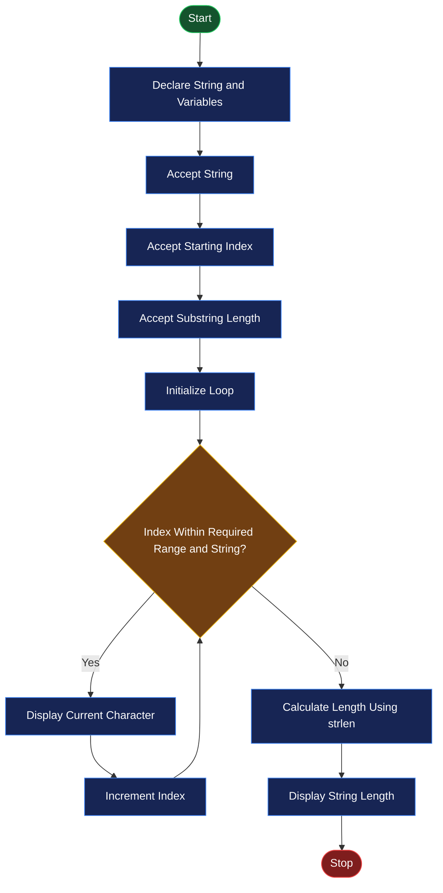

# 🖥️ EXPERIMENT NO. 7
# STRING OPERATIONS USING SHELL SCRIPT AND C PROGRAM

<p align="center">
  
  
  
  
</p>

---

## 📌 AIM

To perform string operations using a Bash shell script and a C program by extracting a substring, calculating the length of a string, and comparing the execution time of both programs.

## 🎯 OBJECTIVES

- To understand string handling in Bash shell scripting.
- To extract a substring from a given string.
- To calculate the length of a string.
- To perform substring extraction using a C program.
- To understand string indexing in Bash and C.
- To compile and execute a C program using GCC.
- To compare the execution time of a shell script and a C program using the `time` command.

## 🛠️ SOFTWARE REQUIREMENTS

| Component | Description |
|---|---|
| Operating System | Ubuntu Linux |
| Virtualization Software | Oracle VirtualBox |
| Shell | Bash |
| Programming Language | C |
| Compiler | GCC |
| Editor | GNU Nano |
| Terminal | Linux Terminal |

---

## 📖 THEORY

### 1. String Operations

A string is a sequence of characters. String operations are used to manipulate and process text.

Common string operations include:

- Finding the length of a string.
- Extracting a substring.
- Accessing individual characters.
- Comparing strings.
- Modifying string contents.

### 2. String Operations in Bash

Bash provides built-in features and commands for handling strings.

| Operation | Syntax | Description |
|---|---|---|
| Read string | `read str` | Accepts a string from the user. |
| Find length | `${#str}` | Returns the length of a string. |
| Extract characters | `cut -c1-5` | Extracts characters from position 1 to 5. |
| Display string | `echo "$str"` | Displays the string. |

**Example:**

```bash
str="COMPUTER"

echo ${#str}
echo "$str" | cut -c2-5
```

Output:

```text
8
OMPU
```

### 3. String Operations in C

In C, strings are stored as character arrays terminated by a null character (`\0`).

The `string.h` header file provides useful string-handling functions.

| Function | Description |
|---|---|
| `strlen()` | Calculates the length of a string. |
| `scanf()` | Reads a string from the user. |
| `printf()` | Displays the string or characters. |

**Example:**

```c
char str[] = "COMPUTER";

printf("%lu", (unsigned long)strlen(str));
```

Output:

```text
8
```

### 4. Difference Between Bash and C String Indexing

| Feature | Bash `cut -c` | C Array |
|---|---|---|
| Starting position | 1-based | 0-based |
| First character | Position 1 | Index 0 |
| Length calculation | `${#str}` | `strlen(str)` |
| Substring extraction | `cut -c` | Character array loop |

**Important:** Bash `cut -c` starts counting characters from 1, whereas C array indexing starts from 0.

### 5. Execution Time Comparison

The `time` command is used to measure how long a command takes to execute.

**Syntax:**

```bash
time command
```

It generally displays:

- Real time: Total elapsed time.
- User time: CPU time spent in user mode.
- System time: CPU time spent in kernel mode.

---

# 💻 PROGRAM IMPLEMENTATION

## PROGRAM 1: EXTRACT SUBSTRING AND FIND STRING LENGTH USING BASH

### Objective

To accept a string from the user, extract a substring from the specified starting position, and calculate the total length of the string using Bash commands.

### Source Code

```bash
#!/bin/bash

echo "Enter a string:"
read str

echo "Enter starting position:"
read start

echo "Enter substring length:"
read len

echo "Substring:"
echo "$str" | cut -c${start}-$((start+len-1))

echo "Length of string: ${#str}"
```

### Explanation

1. `#!/bin/bash` specifies that the script should execute using the Bash shell.
2. `echo` displays a message on the terminal.
3. `read str` accepts a string from the user.
4. `read start` accepts the starting position of the substring.
5. `read len` accepts the required substring length.
6. `cut -c` extracts characters from the specified character positions.
7. `$((start+len-1))` calculates the ending position.
8. `${#str}` calculates and displays the total length of the original string.

### Execution

Create the file:

```bash
nano substring.sh
```

Save the script and execute:

```bash
chmod +x substring.sh
./substring.sh
```

### Expected Output

```text
Enter a string:
COMPUTER

Enter starting position:
2

Enter substring length:
4

Substring:
OMPU
Length of string: 8
```

**Explanation of Example:**

- Original string: `COMPUTER`
- Starting position: `2`
- Substring length: `4`
- Extracted substring: `OMPU`
- Total string length: `8`

*Note: Bash `cut -c` uses 1-based character positions.*

---

## PROGRAM 2: EXTRACT SUBSTRING AND FIND STRING LENGTH USING C

### Objective

To extract a substring from a given string using a C program and calculate its total length using the `strlen()` function.

### Source Code

```c
#include <stdio.h>
#include <string.h>

int main() {
    char str[100];
    int start, len, i;

    printf("Enter a string: ");
    scanf("%99s", str);

    printf("Enter starting position (0-based): ");
    scanf("%d", &start);

    printf("Enter substring length: ");
    scanf("%d", &len);

    printf("Substring: ");

    for (i = start; i < start + len && str[i] != '\0'; i++) {
        if (start >= 0 && len >= 0)
            printf("%c", str[i]);
    }

    printf("\nString length: %lu\n",
           (unsigned long)strlen(str));

    return 0;
}
```

### Explanation

1. `#include <stdio.h>` provides standard input and output functions.
2. `#include <string.h>` provides string-handling functions such as `strlen()`.
3. `int main()` is the main function where program execution begins.
4. `char str[100]` declares a character array that can store a string.
5. `int start, len, i` declares variables for the starting index, substring length, and loop counter.
6. `scanf("%99s", str)` accepts a string from the user.
7. `scanf("%d", &start)` accepts the starting index.
8. `scanf("%d", &len)` accepts the substring length.
9. The `for` loop accesses characters from the starting index up to the required substring length or the end of the string.
10. `printf("%c", str[i])` displays each extracted character.
11. `strlen(str)` calculates the total length of the original string.
12. `return 0` indicates successful program termination.

### Execution

Create the C file:

```bash
nano substring.c
```

Compile the program:

```bash
gcc substring.c -o substring
```

Run the program:

```bash
./substring
```

### Expected Output

```text
Enter a string: COMPUTER
Enter starting position (0-based): 2
Enter substring length: 4
Substring: MPUT
String length: 8
```

**Explanation of Example:**

- Original string: `COMPUTER`
- Starting index: `2`
- Substring length: `4`
- Extracted substring: `MPUT`
- Total string length: `8`

*Note: C uses 0-based indexing. The first character is at index 0.*

---

## PROGRAM 3: COMPARE RUNNING TIME OF BASH AND C PROGRAMS

### Objective

To compare the execution time of the Bash shell script and the compiled C program using the Linux `time` command.

### Commands

**1. Measure Bash Script Execution Time**

```bash
time bash substring.sh
```

**2. Compile the C Program**

```bash
gcc substring.c -o substring
```

**3. Measure C Program Execution Time**

```bash
time ./substring
```

### Explanation

1. `time` measures the execution time of a command.
2. `bash substring.sh` executes the Bash script.
3. `gcc substring.c -o substring` compiles the C source code and creates an executable file named `substring`.
4. `time ./substring` measures the execution time of the compiled C program.
5. The execution times can be compared using the displayed real, user, and system times.

### Expected Output Format

**Bash Execution:**

```text
Enter a string:
COMPUTER
Enter starting position:
2
Enter substring length:
4
Substring:
OMPU
Length of string: 8

real    0m0.0XXs
user    0m0.0XXs
sys     0m0.0XXs
```

**C Program Execution:**

```text
Enter a string: COMPUTER
Enter starting position (0-based): 2
Enter substring length: 4
Substring: MPUT
String length: 8

real    0m0.0XXs
user    0m0.0XXs
sys     0m0.0XXs
```

*Note: The values marked `0.0XXs` are placeholders. Actual execution times depend on the computer, operating system, and system load. The C compilation time is not included in `time ./substring` because compilation is performed separately.*

---

# 🔄 FLOWCHARTS

## Flowchart 1: String Operations Using Bash



## Flowchart 2: String Operations Using C



---

# 📊 COMPARISON BETWEEN BASH AND C

| Feature | Bash Shell Script | C Program |
|---|---|---|
| Language | Bash | C |
| String input | `read` | `scanf()` |
| Substring extraction | `cut -c` | `for` loop |
| Length calculation | `${#str}` | `strlen()` |
| Indexing | 1-based with `cut -c` | 0-based |
| Execution | Directly through Bash | Compile first, then execute |
| Compiler | Not required | GCC required |

### Important Observation

- Bash provides convenient commands for simple text operations.
- C provides direct control over character arrays and string processing.
- Execution-time results depend on the system and should be measured experimentally.
- For a fair comparison, use the same input and repeat measurements several times.

---

# ▶️ EXECUTION PROCEDURE IN UBUNTU

Follow these steps to execute the experiment in Ubuntu Linux using Oracle VirtualBox.

### Step 1: Open Ubuntu Terminal

Press:

```text
Ctrl + Alt + T
```

### Step 2: Create Experiment Directory

```bash
mkdir Experiment-07
cd Experiment-07
```

### Step 3: Create the Bash Script

```bash
nano substring.sh
```

Paste Program 1 into the file.

Save using:

- `Ctrl + O` to save.
- `Enter` to confirm.
- `Ctrl + X` to exit.

### Step 4: Create the C Program

```bash
nano substring.c
```

Paste Program 2 into the file and save it.

### Step 5: Give Permission to the Shell Script

```bash
chmod +x substring.sh
```

### Step 6: Execute the Bash Script

```bash
./substring.sh
```

### Step 7: Compile the C Program

```bash
gcc substring.c -o substring
```

### Step 8: Execute the C Program

```bash
./substring
```

### Step 9: Compare Execution Time

```bash
time bash substring.sh
time ./substring
```

---

# 📸 OUTPUT SCREENSHOTS

Add your actual Ubuntu terminal screenshots in the `screenshots` folder.

### Screenshot 1: Bash String Operations

This screenshot should show:

- Execution of `substring.sh`.
- User input of a string.
- Starting position and substring length.
- Extracted substring.
- Total string length.


### Screenshot 2: C Program and Execution Time Comparison

This screenshot should show:

- Compilation of `substring.c` using GCC.
- Execution of the C program.
- Extracted substring and string length.
- Execution-time output using the `time` command.


> **Important:** Replace these image placeholders by uploading your actual terminal screenshots with the exact filenames shown above.

---

# 📂 PROJECT DIRECTORY STRUCTURE

```text
Experiment-07/
│
├── README.md
│
├── substring.sh
├── substring.c
│
└── screenshots/
    ├── experiment7-bash-string.png
    └── experiment7-c-time-comparison.png
```

---

# 📚 IMPORTANT COMMANDS SUMMARY

| Command / Function | Purpose |
|---|---|
| `read` | Accepts input from the user. |
| `echo` | Displays text on the terminal. |
| `${#str}` | Calculates string length in Bash. |
| `cut -c` | Extracts characters from a string. |
| `scanf()` | Accepts input in C. |
| `printf()` | Displays output in C. |
| `strlen()` | Calculates string length in C. |
| `gcc` | Compiles a C program. |
| `chmod +x` | Gives execution permission to a script. |
| `time` | Measures command execution time. |
| `./substring` | Executes the compiled C program. |

---

# 🎓 LEARNING OUTCOMES

After completing this experiment, the following concepts were understood:

- How to perform string operations using Bash shell scripting.
- How to accept string input from the user.
- How to extract a substring using the `cut` command.
- How to calculate string length using `${#str}`.
- How to perform substring extraction using a C program.
- How to use character arrays and loops in C.
- How to calculate string length using `strlen()`.
- How to compile and execute C programs using GCC.
- How to measure execution time using the Linux `time` command.
- How to compare basic string-processing techniques in Bash and C.

---

# ✅ RESULT

String operations were successfully studied and implemented using Bash shell scripting and a C program. Substring extraction, string length calculation, and execution-time comparison using the Linux `time` command were performed.

---

<p align="center">
  <b>🖥️ OPERATING SYSTEM PRACTICAL</b>
  <br/>
  <i>Experiment No. 07 — String Operations Using Shell Script and C Program</i>
  <br/><br/>
  ⭐ If you find this repository useful, consider giving it a star!
</p>
