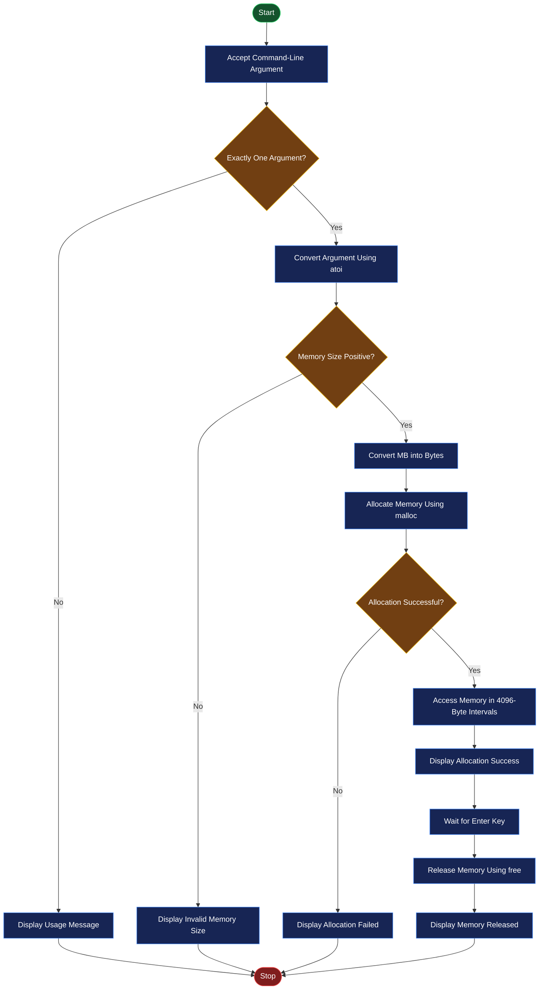
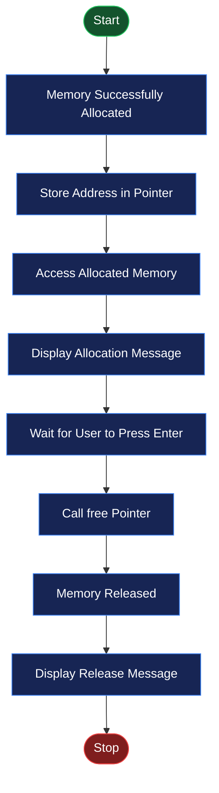

# 🖥️ EXPERIMENT NO. 8
# MEMORY ALLOCATION AND MEMORY USAGE IN C

<p align="center">
  
  
  
  
</p>

---

## 📌 AIM

To study and implement dynamic memory allocation in C using the `malloc()` and `free()` functions, allocate a specified amount of memory in megabytes, access the allocated memory, and release it after use.

## 🎯 OBJECTIVES

- To understand the concept of memory allocation in C.
- To study dynamic memory allocation.
- To understand the use of the `malloc()` function.
- To allocate memory according to the size provided through command-line arguments.
- To check whether memory allocation is successful.
- To access the allocated memory using a pointer.
- To understand the purpose of the `free()` function.
- To release dynamically allocated memory after use.

## 🛠️ SOFTWARE REQUIREMENTS

| Component | Description |
|---|---|
| Operating System | Ubuntu Linux |
| Virtualization Software | Oracle VirtualBox |
| Programming Language | C |
| Compiler | GCC |
| Editor | GNU Nano |
| Terminal | Linux Terminal |
| Header Files | `stdio.h`, `stdlib.h` |

---

## 📖 THEORY

### 1. Memory Management in C

Memory management is the process of allocating, using, and releasing memory while a program is running.

In C, memory can be allocated in two main ways:

- **Static memory allocation:** Memory is allocated before or during program execution with a fixed size.
- **Dynamic memory allocation:** Memory is requested during program execution according to the program's requirements.

Dynamic memory allocation is useful when the required memory size is not known in advance.

### 2. Dynamic Memory Allocation

Dynamic memory allocation allows a program to request memory from the heap while it is running.

C provides the following functions for dynamic memory management:

| Function | Description |
|---|---|
| `malloc()` | Allocates a specified number of bytes. |
| `calloc()` | Allocates memory for multiple elements and initializes it to zero. |
| `realloc()` | Changes the size of previously allocated memory. |
| `free()` | Releases dynamically allocated memory. |

### 3. malloc() Function

The `malloc()` function allocates a specified number of bytes from the heap.

**Syntax:**

```c
pointer = malloc(size);
```

- `pointer` stores the address of allocated memory.
- `size` specifies the required memory in bytes.
- If allocation fails, `malloc()` returns `NULL`.
- The allocated memory is uninitialized.

**Example:**

```c
char *ptr;

ptr = malloc(1024);
```

This statement requests 1024 bytes of memory.

### 4. free() Function

The `free()` function releases dynamically allocated memory.

**Syntax:**

```c
free(pointer);
```

After memory is released, the program should not access that memory through the pointer.

### 5. Command-Line Arguments

Command-line arguments allow users to provide input when executing a program from the terminal.

In C, the main function can be written as:

```c
int main(int argc, char *argv[])
```

| Parameter | Description |
|---|---|
| `argc` | Number of command-line arguments, including the program name. |
| `argv` | Array containing the command-line arguments. |
| `argv[0]` | Program name. |
| `argv[1]` | First argument supplied by the user. |

**Example:**

```bash
./memory 100
```

Here, `100` is passed as the memory size in megabytes.

### 6. Memory Size Calculation

In this experiment, memory is specified in megabytes and converted into bytes.

\[
1\ MB = 1024 \times 1024\ bytes
\]

Therefore:

\[
\text{Memory Size} = MB \times 1024 \times 1024
\]

**Example:**

For 10 MB:

\[
10 \times 1024 \times 1024
= 10,485,760\ bytes
\]

### 7. Pointer

A pointer is a variable that stores the memory address of another variable or allocated memory block.

In this experiment:

```c
char *ptr;
```

The pointer `ptr` stores the address returned by `malloc()`.

---

# 💻 PROGRAM IMPLEMENTATION

## PROGRAM 1: DYNAMIC MEMORY ALLOCATION AND MEMORY USAGE IN C

### Objective

To allocate a specified amount of memory in megabytes using `malloc()`, access the allocated memory, display a success message, wait for the user to press Enter, and release the memory using `free()`.

### Source Code

```c
#include <stdio.h>
#include <stdlib.h>

int main(int argc, char *argv[]) {
    if (argc != 2) {
        printf("Usage: %s <memory_in_MB>\n", argv[0]);
        return 1;
    }

    int mb = atoi(argv[1]);

    if (mb <= 0) {
        printf("Please enter a positive memory size.\n");
        return 1;
    }

    size_t size = (size_t)mb * 1024 * 1024;

    char *ptr = (char *)malloc(size);

    if (ptr == NULL) {
        printf("Memory allocation failed.\n");
        return 1;
    }

    for (size_t i = 0; i < size; i += 4096) {
        ptr[i] = 0;
    }

    printf("%d MB memory allocated successfully.\n", mb);

    printf("Press Enter to release memory...");
    getchar();
    getchar();

    free(ptr);

    printf("Memory released successfully.\n");

    return 0;
}
```

### Explanation

1. `#include <stdio.h>` provides standard input and output functions such as `printf()` and `getchar()`.

2. `#include <stdlib.h>` provides functions such as `malloc()`, `free()`, and `atoi()`.

3. `int main(int argc, char *argv[])` is the main function that accepts command-line arguments.

4. `if (argc != 2)` checks whether exactly one command-line argument has been supplied.

5. `printf("Usage: %s <memory_in_MB>\n", argv[0]);` displays the correct command format if the argument is missing or incorrect.

6. `atoi(argv[1])` converts the supplied memory size from a string into an integer.

7. `if (mb <= 0)` checks whether the entered memory size is positive.

8. `size_t size = (size_t)mb * 1024 * 1024;` converts the memory size from megabytes into bytes.

9. `malloc(size)` dynamically allocates the requested memory from the heap.

10. `if (ptr == NULL)` checks whether memory allocation was successful.

11. The `for` loop accesses the allocated memory at intervals of 4096 bytes.

12. `ptr[i] = 0` writes zero into each selected memory location. This helps ensure that the allocated memory pages are actually accessed.

13. `printf()` displays the successful memory allocation message.

14. `getchar()` waits for the user to press Enter before releasing the memory.

15. `free(ptr)` releases the dynamically allocated memory.

16. `return 0` indicates successful program termination.

### Important Concepts Used

| Concept | Purpose |
|---|---|
| `argc` | Checks the number of command-line arguments. |
| `argv` | Reads the memory size supplied by the user. |
| `atoi()` | Converts text input into an integer. |
| `size_t` | Represents memory sizes and array indexes. |
| `malloc()` | Allocates memory dynamically. |
| `NULL` | Indicates that allocation failed. |
| `for` loop | Accesses allocated memory in intervals. |
| `getchar()` | Waits for user input. |
| `free()` | Releases allocated memory. |

---

# ▶️ EXECUTION PROCEDURE IN UBUNTU

Follow these steps to execute the program in Ubuntu Linux using Oracle VirtualBox.

### Step 1: Open Ubuntu Terminal

Press:

```text
Ctrl + Alt + T
```

### Step 2: Create the Experiment Directory

```bash
mkdir Experiment-08
cd Experiment-08
```

### Step 3: Create the C Program

```bash
nano memory.c
```

Paste the given C program into the file.

Save the file:

- Press `Ctrl + O` to save.
- Press `Enter` to confirm.
- Press `Ctrl + X` to exit.

### Step 4: Compile the C Program

Use GCC to compile the source code:

```bash
gcc memory.c -o memory
```

### Step 5: Run the Program

To allocate 10 MB of memory:

```bash
./memory 10
```

### Step 6: Observe the Output

The program displays a successful memory allocation message and waits for the user to press Enter.

```text
10 MB memory allocated successfully.
Press Enter to release memory...
```

Press Enter.

The program then releases the allocated memory and displays:

```text
Memory released successfully.
```

---

# 📋 EXPECTED OUTPUT

### Case 1: Successful Memory Allocation

**Command:**

```bash
./memory 10
```

**Output:**

```text
10 MB memory allocated successfully.
Press Enter to release memory...
Memory released successfully.
```

### Case 2: No Command-Line Argument

**Command:**

```bash
./memory
```

**Output:**

```text
Usage: ./memory <memory_in_MB>
```

### Case 3: Invalid Memory Size

**Command:**

```bash
./memory 0
```

**Output:**

```text
Please enter a positive memory size.
```

### Case 4: Negative Memory Size

**Command:**

```bash
./memory -5
```

**Output:**

```text
Please enter a positive memory size.
```

### Case 5: Memory Allocation Failure

If the system cannot allocate the requested memory, the program displays:

```text
Memory allocation failed.
```

*Note: Actual allocation success depends on available system resources and operating system memory-management policies.*

---

# 🔄 FLOWCHARTS

## Flowchart 1: Dynamic Memory Allocation



## Flowchart 2: Memory Release Process



---

# 📸 OUTPUT SCREENSHOTS

Add your actual Ubuntu terminal screenshots in the `screenshots` folder.

### Screenshot 1: Compilation and Successful Memory Allocation

This screenshot should show:

- Compilation using GCC.
- Execution with a memory size such as 10 MB.
- Successful memory allocation message.
- Program waiting for the Enter key.


### Screenshot 2: Memory Release and Input Validation

This screenshot should show:

- Memory released successfully after pressing Enter.
- Execution without a command-line argument.
- Execution with an invalid memory size such as 0 or -5.


> **Important:** Replace the screenshot placeholders by uploading your actual Ubuntu terminal screenshots with the exact filenames shown above.

---

# 📂 PROJECT DIRECTORY STRUCTURE

```text
Experiment-08/
│
├── README.md
├── memory.c
│
└── screenshots/
    ├── experiment8-memory-allocation.png
    └── experiment8-memory-release.png
```

---

# 📚 IMPORTANT COMMANDS SUMMARY

| Command / Function | Purpose |
|---|---|
| `nano memory.c` | Creates or edits the C source file. |
| `gcc memory.c -o memory` | Compiles the C program. |
| `./memory 10` | Runs the program with a 10 MB argument. |
| `argc` | Stores the number of command-line arguments. |
| `argv` | Stores command-line argument values. |
| `atoi()` | Converts a string into an integer. |
| `malloc()` | Allocates memory dynamically. |
| `free()` | Releases allocated memory. |
| `getchar()` | Reads a character from standard input. |
| `size_t` | Represents memory sizes and indexes. |

---

# 🎓 LEARNING OUTCOMES

After completing this experiment, the following concepts were understood:

- The concept of memory management in C.
- The difference between static and dynamic memory allocation.
- How to allocate memory using the `malloc()` function.
- How to release memory using the `free()` function.
- How to use pointers for accessing dynamically allocated memory.
- How to accept input through command-line arguments.
- How to convert memory size from megabytes into bytes.
- How to check whether memory allocation is successful.
- How to access allocated memory using a loop.
- How to compile and execute C programs using GCC in Ubuntu Linux.

---

# ⚠️ IMPORTANT OBSERVATION

- `malloc()` allocates memory but does not initialize it.
- The program writes to one byte in every 4096-byte interval to access the allocated memory pages.
- Successful allocation does not always mean that the entire requested memory has already been physically backed by RAM; operating systems may use virtual memory and demand paging.
- `free()` releases the allocated memory back to the memory allocator.
- The program waits for the Enter key so that the allocated memory remains in use until the user chooses to release it.

---

# ✅ RESULT

Dynamic memory allocation and memory usage in C were successfully studied and implemented using the `malloc()` and `free()` functions. Memory was allocated according to the size supplied through command-line arguments, accessed using a pointer, and released after use.

---

<p align="center">
  <b>🖥️ OPERATING SYSTEM PRACTICAL</b>
  <br/>
  <i>Experiment No. 08 — Memory Allocation and Memory Usage in C</i>
  <br/><br/>
  ⭐ If you find this repository useful, consider giving it a star!
</p>
