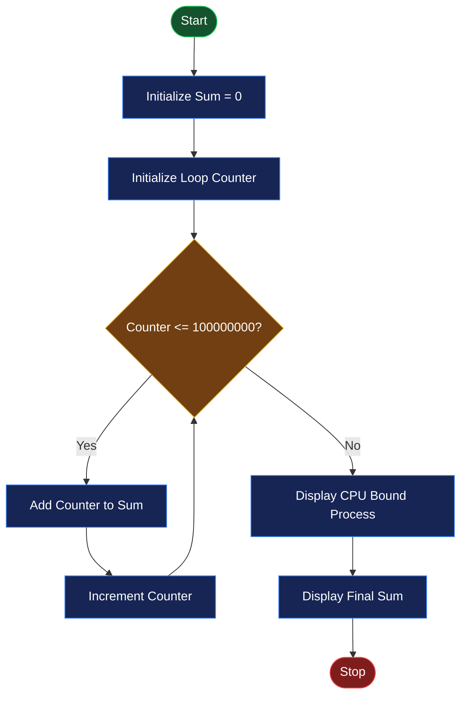
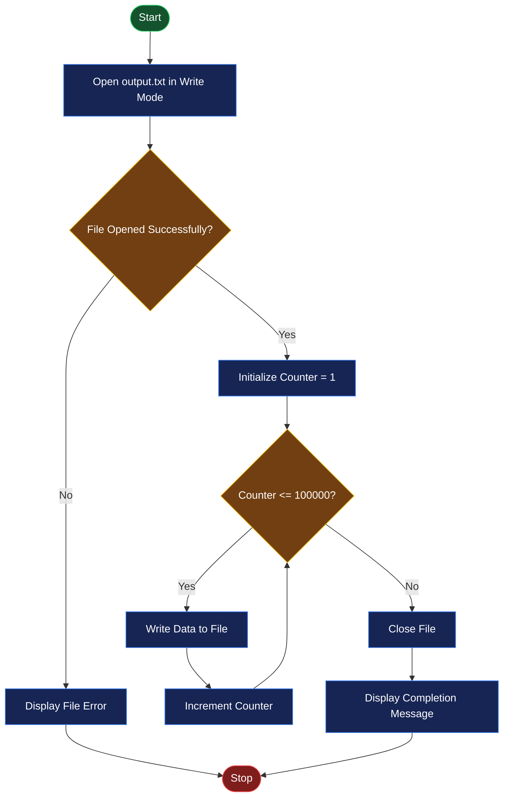

# 🖥️ EXPERIMENT NO. 9
# CPU-BOUND AND I/O-BOUND PROCESSES

<p align="center">
  
  
  
  
</p>

---

## 📌 AIM

To study and compare CPU-bound and I/O-bound processes in an operating system by executing C programs, monitoring their resource usage using the `top` command, and examining their memory maps using the `pmap` command.

## 🎯 OBJECTIVES

- To understand the concept of CPU-bound processes.
- To understand the concept of I/O-bound processes.
- To implement a CPU-bound program using repeated calculations.
- To implement an I/O-bound program using file operations.
- To compile and execute C programs using GCC.
- To monitor process activity using the `top` command.
- To examine process memory information using the `pmap` command.
- To compare CPU-intensive and input/output-intensive activities.

## 🛠️ SOFTWARE REQUIREMENTS

| Component | Description |
|---|---|
| Operating System | Ubuntu Linux |
| Virtualization Software | Oracle VirtualBox |
| Programming Language | C |
| Compiler | GCC |
| Editor | GNU Nano |
| Terminal | Linux Terminal |
| Monitoring Commands | `top`, `pmap`, `ps` |

---

## 📖 THEORY

### 1. Process in Operating System

A process is a program that is currently being executed by the operating system.

A process requires system resources such as:

- CPU time.
- Main memory.
- Input/output devices.
- Files and other system resources.

The operating system manages processes and allocates resources to them.

### 2. CPU-Bound Process

A CPU-bound process is a process that spends most of its execution time performing calculations and using the CPU.

It requires more processing power than input/output operations.

**Examples:**

- Mathematical calculations.
- Image processing.
- Video encoding.
- Scientific simulations.
- Complex numerical computations.

**Characteristics:**

- Performs repeated calculations.
- Requires significant CPU processing time.
- Often has high CPU utilization while running.
- Performance depends heavily on processor speed and available CPU cores.

### 3. I/O-Bound Process

An I/O-bound process is a process that spends a significant amount of time performing input/output operations rather than calculations.

It may interact with files, disks, keyboards, networks, and other input/output devices.

**Examples:**

- Reading data from files.
- Writing data to files.
- Database operations.
- Network communication.
- File transfer operations.

**Characteristics:**

- Performs frequent input/output operations.
- May spend time waiting for I/O completion.
- CPU utilization can be lower than that of a CPU-bound process.
- Performance depends on the speed of the input/output device and system resources.

### 4. Difference Between CPU-Bound and I/O-Bound Processes

| Feature | CPU-Bound Process | I/O-Bound Process |
|---|---|---|
| Main activity | Calculations | Input/output operations |
| Main resource | CPU | I/O devices |
| CPU utilization | Generally high while executing | Often lower, depending on I/O |
| Waiting time | Usually less I/O waiting | May spend time waiting for I/O |
| Example | Repeated mathematical calculations | Writing data to a file |
| Performance depends on | Processor speed | I/O performance |

### 5. Process Monitoring Using `top`

The `top` command displays real-time information about running processes.

**Syntax:**

```bash
top
```

It displays information such as:

- Process ID (PID).
- CPU utilization.
- Memory utilization.
- Process state.
- User information.
- Running processes.

Press `q` to exit the `top` interface.

### 6. Process Memory Mapping Using `pmap`

The `pmap` command displays the memory map of a process.

**Syntax:**

```bash
pmap PID
```

It provides information about:

- Memory addresses.
- Memory regions.
- Memory sizes.
- Shared and private memory mappings.
- Total mapped memory.

Replace `PID` with the actual process ID.

### 7. Process ID (PID)

A Process ID is a unique number assigned by the operating system to identify a running process.

To display process information:

```bash
ps
```

To search for a particular process:

```bash
pgrep -a cpu
```

To obtain detailed process information:

```bash
ps aux
```

---

# 💻 PROGRAM IMPLEMENTATION

## PROGRAM 1: CPU-BOUND C PROGRAM

### Objective

To create a CPU-bound process that performs repeated mathematical calculations using a loop and displays the final sum.

### File Name

`cpu_bound.c`

### Source Code

```c
#include <stdio.h>

int main(void) {
    volatile unsigned long long sum = 0;

    for (unsigned long long i = 1; i <= 100000000ULL; i++) {
        sum += i;
    }

    printf("CPU Bound Process\n");
    printf("Sum = %llu\n", sum);

    return 0;
}
```

### Explanation

1. `#include <stdio.h>` includes the standard input/output header file.
2. `int main(void)` is the main function where program execution begins.
3. `volatile unsigned long long sum = 0;` declares a variable to store the calculated sum.
4. The `volatile` keyword prevents the compiler from assuming that the variable never needs to be updated or observed.
5. The `for` loop executes from 1 to 100,000,000.
6. `sum += i` adds each number to the previous sum.
7. The program performs a large number of repeated calculations, making it CPU-intensive.
8. `printf()` displays the process type and final sum.
9. `return 0` indicates successful program termination.

### Execution

Create the C file:

```bash
nano cpu_bound.c
```

Compile the program:

```bash
gcc cpu_bound.c -o cpu
```

Run the program:

```bash
./cpu
```

### Expected Output

```text
CPU Bound Process
Sum = 5000000050000000
```

### Observation

- The program performs 100 million iterations.
- It spends most of its execution time performing arithmetic calculations.
- CPU utilization may increase while the program is running.
- The actual execution time depends on the processor and system load.

---

## PROGRAM 2: I/O-BOUND C PROGRAM

### Objective

To create an I/O-bound process that writes a large number of lines into a file using file-handling functions in C.

### File Name

`io_bound.c`

### Source Code

```c
#include <stdio.h>

int main(void) {
    FILE *fp = fopen("output.txt", "w");

    if (fp == NULL) {
        perror("fopen");
        return 1;
    }

    for (int i = 1; i <= 100000; i++) {
        fprintf(fp, "Writing data: %d\n", i);
    }

    fclose(fp);

    printf("I/O Bound Process Completed\n");
    return 0;
}
```

### Explanation

1. `#include <stdio.h>` includes the standard input/output header file.
2. `int main(void)` is the main function.
3. `FILE *fp` declares a file pointer.
4. `fopen("output.txt", "w")` opens the file in write mode.
5. If the file does not exist, it is created.
6. If the file already exists, its previous contents are overwritten.
7. `if (fp == NULL)` checks whether the file was opened successfully.
8. `perror("fopen")` displays an error message if the file operation fails.
9. The `for` loop executes 100,000 times.
10. `fprintf()` writes a line of text into the file during each iteration.
11. `fclose(fp)` closes the file and flushes buffered output.
12. `printf()` displays the completion message.
13. `return 0` indicates successful program termination.

### Execution

Create the C file:

```bash
nano io_bound.c
```

Compile the program:

```bash
gcc io_bound.c -o io
```

Run the program:

```bash
./io
```

### Expected Output

```text
I/O Bound Process Completed
```

### Generated File

The program creates a file named `output.txt`.

To display its contents:

```bash
head output.txt
```

To display the last few lines:

```bash
tail output.txt
```

To count the total number of lines:

```bash
wc -l output.txt
```

Expected line count:

```text
100000 output.txt
```

### Observation

- The program writes 100,000 lines into a file.
- It performs repeated file-writing operations.
- File operations involve the operating system and storage system.
- Actual CPU utilization and execution time depend on buffering, storage speed, and system conditions.

---

# ▶️ COMPILATION AND EXECUTION PROCEDURE

### Step 1: Open Ubuntu Terminal

Press:

```text
Ctrl + Alt + T
```

### Step 2: Create the Experiment Directory

```bash
mkdir Experiment-09
cd Experiment-09
```

### Step 3: Create the CPU-Bound Program

```bash
nano cpu_bound.c
```

Paste Program 1 and save the file.

### Step 4: Create the I/O-Bound Program

```bash
nano io_bound.c
```

Paste Program 2 and save the file.

### Step 5: Compile Both Programs

Compile the CPU-bound program:

```bash
gcc cpu_bound.c -o cpu
```

Compile the I/O-bound program:

```bash
gcc io_bound.c -o io
```

### Step 6: Execute the CPU-Bound Program

```bash
./cpu
```

### Step 7: Execute the I/O-Bound Program

```bash
./io
```

### Step 8: Verify the Generated Files

```bash
ls -lh
```

The directory should contain:

- `cpu_bound.c`
- `io_bound.c`
- `cpu`
- `io`
- `output.txt`

---

# 📊 PROCESS MONITORING

## 1. Monitor Processes Using TOP

The `top` command is used to monitor running processes and observe CPU and memory utilization.

**Command:**

```bash
top
```

### Steps

1. Open a terminal.
2. Start the `top` command.
3. Open another terminal.
4. Execute the CPU-bound or I/O-bound program while `top` is running.
5. Observe the process list and CPU utilization.
6. Press `q` to exit `top`.

### Important Information Displayed by TOP

| Column | Description |
|---|---|
| PID | Process identification number. |
| USER | User who owns the process. |
| %CPU | CPU utilization percentage. |
| %MEM | Memory utilization percentage. |
| TIME+ | Total CPU time used by the process. |
| COMMAND | Process or command name. |

## 2. Find Process ID

To find the running CPU program:

```bash
pgrep -a cpu
```

To find the running I/O program:

```bash
pgrep -a io
```

You can also use:

```bash
ps aux
```

**Note:** These programs may finish quickly. If a process has already completed, it will no longer appear in the running process list.

## 3. View Process Memory Map Using PMAP

The `pmap` command displays the memory map of a running process.

**Syntax:**

```bash
pmap PID
```

Example:

```bash
pmap 1234
```

Here, `1234` is an illustrative PID. Replace it with the actual PID displayed by your system.

To display the total memory information:

```bash
pmap -x PID
```

### Information Displayed by PMAP

- Memory address ranges.
- Memory mapping sizes.
- Permissions and mapped regions.
- Shared and private memory.
- Total mapped memory.

---

# 🔄 FLOWCHARTS

## Flowchart 1: CPU-Bound Process



## Flowchart 2: I/O-Bound Process



---

# 📈 COMPARISON BETWEEN CPU-BOUND AND I/O-BOUND PROCESSES

| Feature | CPU-Bound Program | I/O-Bound Program |
|---|---|---|
| Main operation | Mathematical calculations | Writing data to a file |
| Primary resource | CPU | Storage and I/O subsystem |
| Main function | Repeated addition | `fprintf()` |
| Loop iterations | 100 million | 100,000 |
| Output | Calculated sum | File containing 100,000 lines |
| CPU usage | Generally higher while running | Depends on file buffering and storage |
| Main performance factor | Processor speed | I/O performance and buffering |

### Important Observation

- The CPU-bound program performs a large number of arithmetic operations.
- The I/O-bound program writes data to a file using file-handling functions.
- The `top` command helps observe process activity and resource utilization.
- The `pmap` command helps examine process memory mappings.
- Actual CPU usage may vary depending on hardware, operating system, storage speed, and system load.

**Note:** The I/O-bound program uses buffered file output. Therefore, its CPU utilization may not always be low, and the program may complete quickly because many writes are handled through memory buffering before being sent to storage.

---

# 📸 OUTPUT SCREENSHOTS

Add your actual Ubuntu terminal screenshots in the `screenshots` folder.

### Screenshot 1: CPU-Bound and I/O-Bound Program Execution

This screenshot should show:

- Compilation of `cpu_bound.c`.
- Execution of the CPU-bound program.
- Display of the calculated sum.
- Compilation of `io_bound.c`.
- Execution of the I/O-bound program.
- Successful completion message.


### Screenshot 2: Process Monitoring Using TOP and PMAP

This screenshot should show:

- Running the `top` command.
- CPU and memory utilization information.
- Process ID of a running program, if available.
- Running the `pmap` command with the actual PID.


> **Important:** Replace these image placeholders with your actual Ubuntu terminal screenshots. Save them using the exact filenames shown above and upload them to your GitHub repository.

---

# 📂 PROJECT DIRECTORY STRUCTURE

```text
Experiment-09/
│
├── README.md
│
├── cpu_bound.c
├── io_bound.c
│
├── cpu
├── io
├── output.txt
│
└── screenshots/
    ├── experiment9-program-execution.png
    └── experiment9-process-monitoring.png
```

---

# 📚 IMPORTANT COMMANDS SUMMARY

| Command / Function | Purpose |
|---|---|
| `nano cpu_bound.c` | Creates or edits the CPU-bound source file. |
| `nano io_bound.c` | Creates or edits the I/O-bound source file. |
| `gcc cpu_bound.c -o cpu` | Compiles the CPU-bound program. |
| `gcc io_bound.c -o io` | Compiles the I/O-bound program. |
| `./cpu` | Executes the CPU-bound program. |
| `./io` | Executes the I/O-bound program. |
| `top` | Monitors running processes. |
| `ps aux` | Displays detailed process information. |
| `pgrep -a cpu` | Searches for the CPU program process. |
| `pgrep -a io` | Searches for the I/O program process. |
| `pmap PID` | Displays a process memory map. |
| `pmap -x PID` | Displays extended memory mapping information. |
| `head output.txt` | Displays the beginning of the output file. |
| `tail output.txt` | Displays the end of the output file. |
| `wc -l output.txt` | Counts lines in the output file. |

---

# 🎓 LEARNING OUTCOMES

After completing this experiment, the following concepts were understood:

- The concept of processes in an operating system.
- The difference between CPU-bound and I/O-bound processes.
- How CPU-intensive tasks perform repeated calculations.
- How I/O-intensive tasks perform file operations.
- How to write and compile C programs using GCC.
- How to use file-handling functions such as `fopen()`, `fprintf()`, and `fclose()`.
- How to monitor running processes using the `top` command.
- How to identify process IDs using `pgrep` and `ps`.
- How to examine process memory mappings using the `pmap` command.
- How the operating system manages CPU and I/O resources.

---

# ⚠️ IMPORTANT OBSERVATIONS

1. The CPU-bound program performs 100 million addition operations.
2. The I/O-bound program writes 100,000 lines into `output.txt`.
3. CPU utilization depends on the system's processor, available cores, and current workload.
4. The I/O-bound program uses buffered output, so its actual storage activity may not occur once for every `fprintf()` call.
5. Short-running programs may finish before they can be inspected using `top` or `pmap`.
6. The PID used with `pmap` must belong to a process that is still running.

---

# ✅ RESULT

CPU-bound and I/O-bound processes were successfully studied and implemented using C programs. The CPU-bound program performed repeated mathematical calculations, while the I/O-bound program performed file-writing operations. Process activity was studied using the `top` command, and process memory mappings were examined using the `pmap` command.

---

<p align="center">
  <b>🖥️ OPERATING SYSTEM PRACTICAL</b>
  <br/>
  <i>Experiment No. 09 — CPU-Bound and I/O-Bound Processes</i>
  <br/><br/>
  ⭐ If you find this repository useful, consider giving it a star!
</p>


